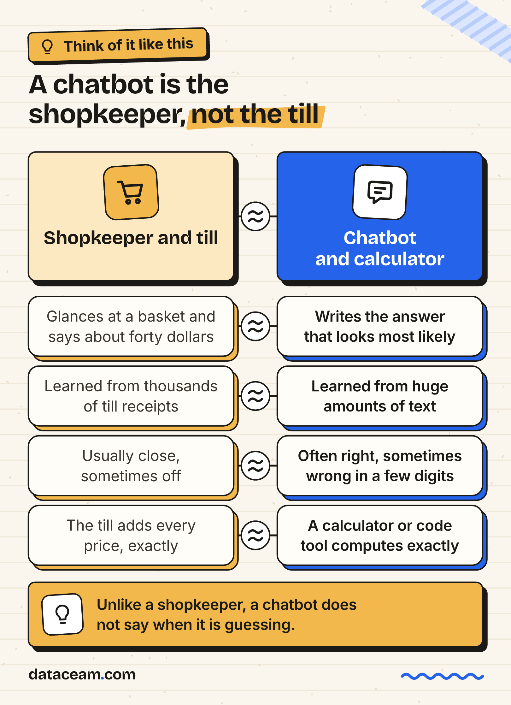
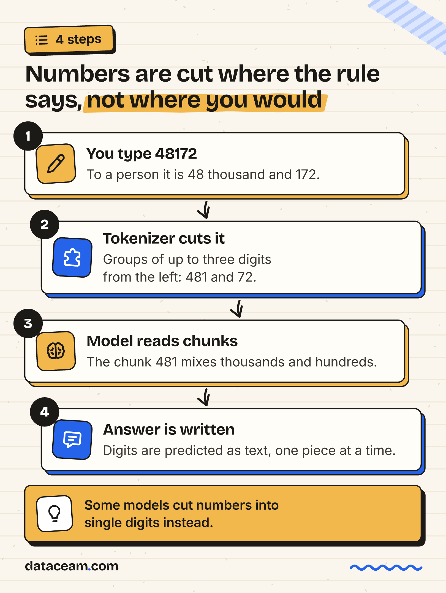
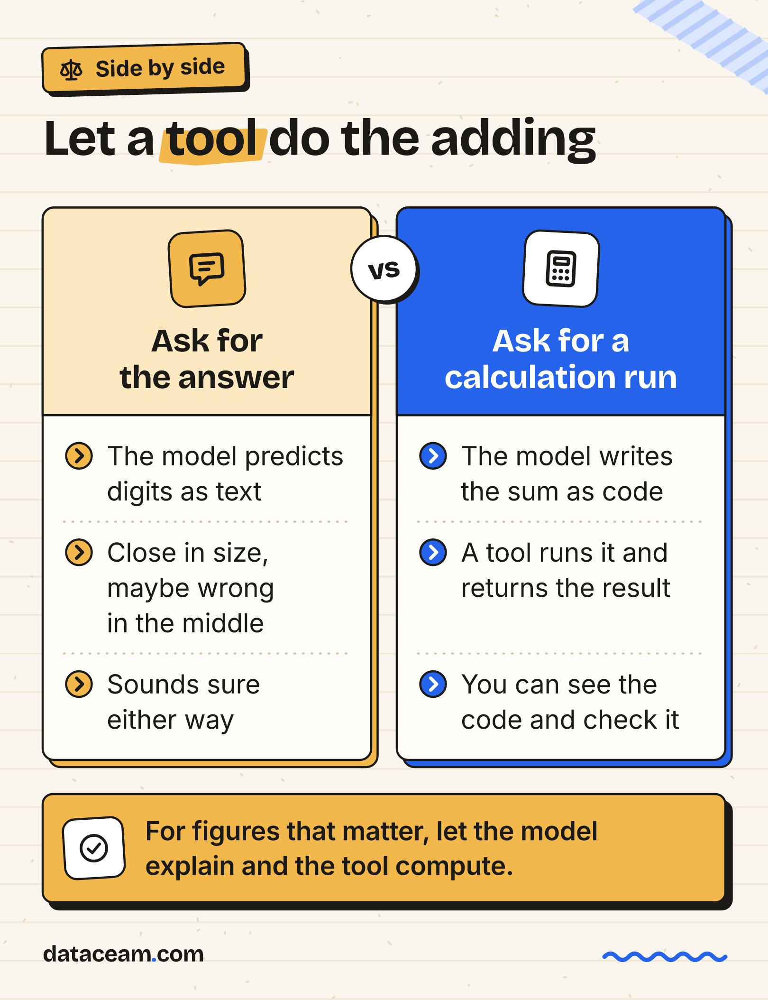

AI is bad at math because a chatbot is built to predict the next piece of text, not to calculate. When you ask for 48,172 plus 39,856, it produces the answer that looks most like what usually follows such a question. That is often right for short sums and sometimes wrong by a digit or two for long ones. A calculator works the other way round: it runs fixed rules and is never "almost" right.

This matters whenever a number goes somewhere that counts. You might split a restaurant bill, check a loan payment or add up expenses for a tax form. The chatbot's answer will sound sure of itself in every case. Knowing why it slips helps you decide when to trust it and when to reach for a calculator.

## Why is AI bad at math when the sum looks simple?

Chatbots get sums wrong because they are language models, which write text one small piece at a time, and nothing inside them is a calculator. [A large language model](/guides/what-is-an-llm/) learns from huge amounts of writing which words and numbers tend to follow which. Asked a sum, it doesn't run an adding routine. It writes digits that fit the pattern.

Think of a shopkeeper who has looked at thousands of till receipts. Show them a basket and they can say "that's about forty dollars" at a glance, and they are usually close. The till does something else: it adds every price, exactly, every time. A chatbot is the shopkeeper, not the till.

*The shopkeeper is fast and usually near the mark. Only the till gives the exact total.*

The comparison stops being fair in one place. A shopkeeper knows when they are guessing and may say so. A chatbot doesn't flag a guess, because nothing in how it writes marks an estimate as different from an exact result. More on that below.

> **In short:** A chatbot predicts text that looks like an answer. It has no built-in calculator, so exact arithmetic is not its natural strength.

## Why do numbers get split into pieces?

A model doesn't read your number as one value. It reads it in tokens, which are small chunks of text, and a long number is cut into several of them. This matters because the cuts may fall in places that hide the digits' place value. [The guide to tokens](/guides/tokens/) explains the general idea.

Here is a real rule. A tokenizer is the program that turns text into tokens before the model sees it. OpenAI's open-source tokenizer, called tiktoken, uses a pattern in its newer vocabularies that [cuts runs of digits into groups of one to three](https://raw.githubusercontent.com/openai/tiktoken/main/tiktoken_ext/openai_public.py), reading from the left. Other companies' models can differ. A study of arithmetic in large models notes that [GPT-3.5 and GPT-4 have a separate token for each one-, two- and three-digit number](https://arxiv.org/abs/2402.14903), while LLaMa (from Meta) and PaLM (from Google) split numbers into single digits.

Apply the three-digit rule from the left to a five-digit number, 48172. The cut is 481 and 72. A person reads the same number as 48 thousand and 172, grouping from the right. So the first chunk the model sees, 481, isn't "forty-eight thousand" at all. It mixes thousands and hundreds.

| Number | Cut from the left, up to 3 digits | How a person groups it |
|---|---|---|
| 48172 | 481 and 72 | 48 and 172 |
| 39856 | 398 and 56 | 39 and 856 |
| 4817293650 | 481, 729, 365 and 0 | 4, 817, 293 and 650 |

Commas change this. If you type 48,172 with the comma, the tokenizer cuts at the comma, so the chunks match the way a person groups the number.

The same study tested what this does. The authors made models group the digits from the right, by adding commas, and [right-to-left grouping did much better than the default](https://arxiv.org/abs/2402.14903) for GPT-3.5 and GPT-4. They also found that the gap shrinks as models get larger. The splitting is one cause of mistakes, and not the only one.

*The chunks fall where the cutting rule puts them, not where a person would put the commas.*

### Is AI bad at counting letters for the same reason?

Partly. Models read tokens, not single letters, but a [2024 study](https://arxiv.org/abs/2412.18626) found that models can recognize letters and still miscount them, especially letters that repeat. [The guide to tokens](/guides/tokens/) covers the causes.

## How does an AI model actually add?

A model doesn't add the way you were taught at school. Anthropic studied the inside of its Claude model with sums such as 36 plus 59 and reported that it [uses several paths in parallel](https://www.anthropic.com/research/tracing-thoughts-language-model). One path gives a rough estimate of the total. A second path works out the last digit exactly. The two are then combined into the answer, which here is 95.

This fits the shopkeeper. The rough path is the glance at the basket, and the exact-digit path is a careful check of one detail. It may also help explain a common kind of slip. An answer that is close in size and right in the last digit can still be wrong in the digits in between.

The same research found something odd. Asked how it got 95, the model described the school method, [carrying the 1](https://www.anthropic.com/research/tracing-thoughts-language-model), which isn't what the researchers saw happening inside it. The authors suggest this is because the model learned to explain math by copying human explanations, while it built its own way to compute. So a model's description of its method may not match what it did. This is one study of one model family, and other models may work differently.

> **In short:** Research on one model found a rough path and an exact-digit path working side by side. The model's own account of its method was the school one, which isn't what it did.

## A worked example: one sum, done three ways

Take 48,172 + 39,856. The right answer is 88,028, and you can follow each step yourself. The "chatbot" answer below is made up to show the typical kind of slip. It isn't a recorded result from any product.

1. Do it the school way, from the right. 2 + 6 = 8. Then 7 + 5 = 12, so write 2 and carry 1. Then 1 + 8 + 1 = 10, so write 0 and carry 1. Then 8 + 9 + 1 = 18, so write 8 and carry 1. Last, 4 + 3 + 1 = 8. The total is 88,028.
2. Now suppose a chatbot answers in one go: "88,128". It has the right size (about 88 thousand) and a plausible ending, and it reads as fluent as the right answer. But it is off by 100 (88,128 − 88,028), because the middle digit is wrong.
3. Check the answer with a rough estimate. Round to 48,000 + 40,000 = 88,000. Both 88,028 and 88,128 pass this test, so an estimate alone can't catch a slip this small.
4. Check the last digit. 2 + 6 ends in 8, and both answers end in 8, so that passes too. Quick checks catch big errors, but a small one in the middle can slip through.
5. So hand the sum to a tool. A code tool runs `48172 + 39856` and returns 88028 every time.

The lesson from step 4 is the one to keep. Quick checks on a figure are good, but they don't prove it. For an amount that matters, the calculation itself should be done by something that calculates.

## Why do wrong answers sound so confident?

Wrong answers sound confident because the model writes every answer in the same fluent style, whether the content is correct or not. It has no gauge that makes the tone shaky when the digits are shaky. Whatever is written next just has to sound like a good answer.

Anthropic's research shows this in a case with a harder problem. When asked for the cosine of a large number, the model sometimes [claimed to have run a calculation](https://www.anthropic.com/research/tracing-thoughts-language-model), and the researchers found no evidence of that calculation inside it. They compared this to making something up without caring whether it is true. That is one case in one study. But it shows why you can't judge a number by how sure the chatbot sounds.

There is a second reason. If you ask again, you may get another figure, because the text is partly chosen by chance. [The guide on why AI gives different answers](/guides/different-answers/) covers that. For a sum, two different answers to the same question is a warning sign in itself.

## Do newer models and step-by-step answers help?

Yes, often. Writing out the steps helps, and using a tool helps more. But how much depends on the model and version, so treat any claim that "AI now does math perfectly" with care.

Step-by-step writing is called chain-of-thought prompting. Researchers at Google showed that giving a model examples with the intermediate steps [improved its results on math word problems](https://arxiv.org/abs/2201.11903), and a very large model (540 billion parameters) set a new best score on a school-level math test called GSM8K. It helps because each small step is easier to get right than a long jump, and the written steps become part of what the model reads next. Some newer models do this on their own before they answer. Reasoning models, which work through a problem in writing before they answer, are built around the same idea.

Tools go further. In a method called PAL, short for program-aided language models, the model writes a small program and a normal interpreter (the program that runs code) carries it out. The authors report that this [beat a chain-of-thought model on GSM8K by 15 percentage points](https://arxiv.org/abs/2211.10435) even though the other model was much larger.

*Both routes use the model to read the question. Only one of them lets a calculator do the adding.*

Some AI tools can now do this for you. Google's documentation says Gemini's code execution lets the model [write and run Python code and learn from the results](https://aistudio.google.com/docs/code-execution), and Anthropic's documentation says Claude's code execution tool runs [code in a sandboxed environment](https://platform.claude.com/docs/en/agents-and-tools/tool-use/code-execution-tool). A sandbox is a closed space where code runs without touching anything else. Whether a given chat app turns this on, and when, varies, so check what you are using.

> **In short:** Showing steps helps. Letting the model write code that a computer runs helps more, because the adding is then done by a machine that adds.

## How can you get correct math answers from AI?

Use the AI to set up the problem and explain it, and use a calculator, a spreadsheet or a code tool to compute any figure that matters. That one rule covers most cases.

Here is how to put it into practice.

1. Ask for the method first: "What formula do I use to work out monthly loan payments?" Models are good at this kind of explanation.
2. Compute with a tool. Type the numbers into a spreadsheet or calculator, or ask the chatbot to use its code or data-analysis feature if it has one.
3. Look for evidence that a tool ran. Many apps show a code block or a "ran code" label. If you see only plain text, the model probably answered by prediction.
4. Ask for steps and check them. Even when no tool is used, each written step is easier to verify than a single final figure.
5. Do the quick checks: round and estimate, and look at the last digit. They catch large errors.
6. For tax, accounting or legal amounts, have the final numbers checked by a qualified person. An AI answer is a draft.

You can also run a test of your own, in a couple of minutes. Ask your chatbot for 48,172 × 39,856 with no tool. The correct result is 1,919,943,232 (you can check it on any calculator). See how close it gets, then ask again, then ask it to use code. Results vary by model and version, so what you see may be different from someone else's.

## Common mistakes and myths about AI and math

Most of these come from treating a fluent answer as a checked one.

1. **Myth: AI is bad at all math.** It can explain concepts, solve many school-level word problems and write formulas and code. The weak spot is exact arithmetic on long numbers without a tool.
2. **Myth: if it shows its steps, the answer is right.** Steps help, but the steps themselves can contain slips. Research on one model also found that its description of its method didn't match what it did inside.
3. **Mistake: judging by tone.** A confident answer and a correct answer are different things.
4. **Mistake: trusting one run.** If you ask twice and get two figures, at least one is wrong.
5. **Myth: new versions fixed it for good.** Newer models and tool use improve results, but how much depends on the model and the app. Check the figure that matters.

## What to read or try next

Pick one real sum from your own life, such as a bill, a budget line or a loan payment. Ask a chatbot to do it directly, then ask it to use a code or calculator tool, and compare both with your spreadsheet.

To go deeper, the guide on [how large language models work](/guides/what-is-an-llm/) shows the next-word idea behind all of this, and [the guide to tokens](/guides/tokens/) explains the cutting of text and numbers in detail. The [LLM basics page](/guides/topic/llm-basics/) lists the other guides on this subject.
