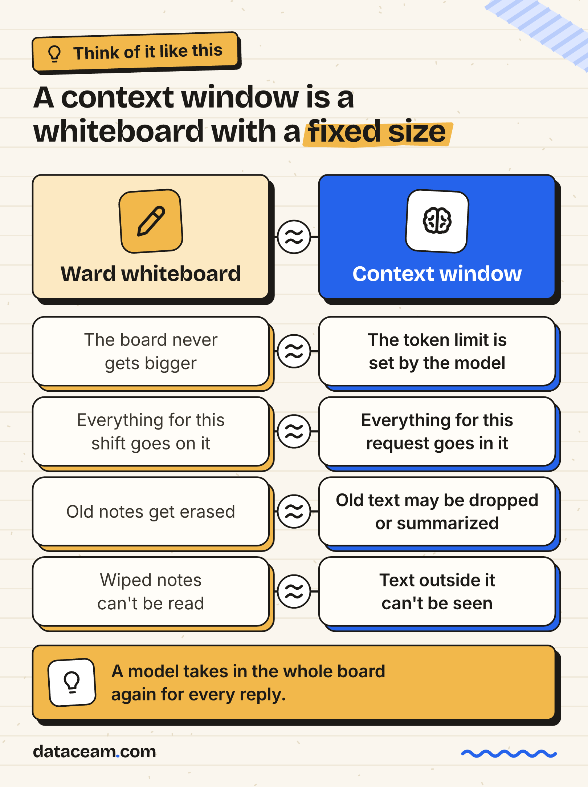
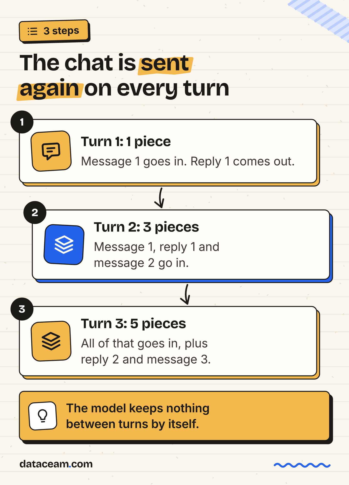
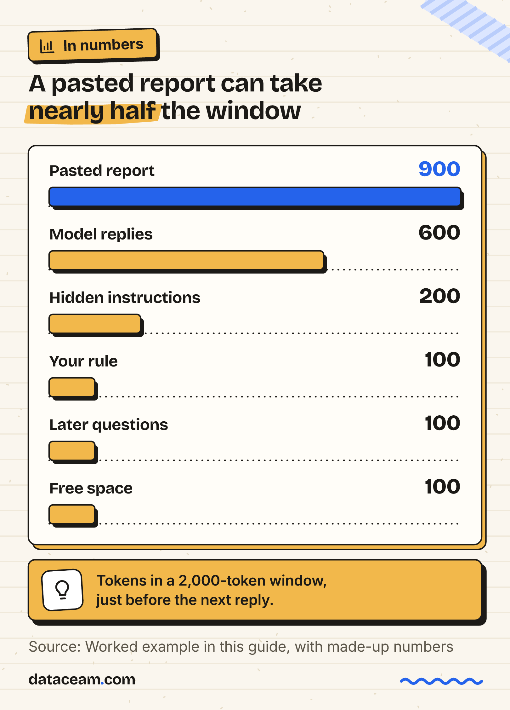

A context window is the largest amount of text an AI model can work with at one time. It is counted in [tokens](/guides/tokens/), which are small chunks of text, often a word or part of one. Your messages, anything you paste and, usually, the model's own answer all have to fit inside it. Once it is full, something has to give.

You may have met the limit without knowing its name. You tell a chatbot to answer in short bullet points. An hour later it is back to long paragraphs, as if you never asked. Knowing how the window works helps explain why that can happen and what to try.

## What is a context window in AI?

A context window in AI is the model's working space for one request. OpenAI's documentation defines it as ["the maximum number of tokens that can be used in a single request"](https://developers.openai.com/api/docs/guides/conversation-state), counting what goes in and what comes out.

Picture the whiteboard on a hospital ward. It has a fixed size. Everything the team needs for this shift has to fit on it: patients, medicines, jobs to do. When there is no space left, somebody erases old notes to make room.

*Nurses may remember a note after it is wiped. A model has only what is still on the board.*

The picture has limits. The app, not the model, decides what gets wiped. And a nurse glances at the board and walks away with the facts in mind. A model takes in the board again from the start for every reply. What it learned in training is stored elsewhere, in its parameters, the billions of numbers that were set before you ever opened the chat. Anthropic draws the same line: the window is a kind of ["working memory"](https://platform.claude.com/docs/en/build-with-claude/context-windows), separate from the training text.

### What counts toward the context window?

Nearly everything in the request counts, including parts you never see.

| What takes up space | Example |
|---|---|
| Hidden instructions | Rules the app gives the model, often called the system prompt |
| Your messages | Every question and instruction so far |
| The model's replies | Every answer it has already given you |
| Files and images | A pasted report, a PDF, a photo |
| The answer being written | It usually needs free space too |

IBM points out that the system prompt is [often hidden from the user](https://www.ibm.com/think/topics/context-window), so the window is rarely as empty as it looks when you type your first word.

Some models count the answer separately. Google says its earlier Gemini 3 and 2.5 models have [one limit for input and another for output](https://ai.google.dev/gemini-api/docs/long-context).

> **In short:** The context window is one space for instructions, messages, files and usually the answer. Text that isn't in it, the model can't see.

## Why does AI forget what you said earlier?

AI can forget what you said because older text has been dropped or summarized, or because the model missed it in a long chat. The model itself keeps nothing between messages. OpenAI describes each request as [independent and stateless](https://developers.openai.com/api/docs/guides/conversation-state). Stateless means that nothing carries over from the last request on its own.

A chat feels continuous because the earlier conversation goes back to the model with each new message. On turn one, it gets your first message. On turn two, it gets the first message, its own first reply and your second message. By turn twenty it is working through a long transcript before it writes a word.

*In a typical chat, the pile grows by two pieces every turn until the window is full: the last reply and your new message.*

So an instruction can go missing in more than one way. It may have been dropped to make room. It may have been squeezed into a summary that left it out. Or it may still be in the window, and the model gave it too little weight among everything else.

## A worked example: filling a 2,000-token window

Here is a small chat in an imaginary app with a 2,000-token window. Real windows are far larger, but the math works the same way. IBM's rough estimate is [1.5 tokens per word](https://www.ibm.com/think/topics/context-window), so 2,000 tokens is about 1,333 words (2,000 ÷ 1.5). The real figure varies by model and by text.

1. The app's hidden instructions take 200 tokens. Total: 200.
2. You write your rule, "always answer in short bullet points", along with a little background. That takes 100 tokens. Total: 300.
3. In the same message you paste a 600-word report, about 900 tokens. Total: 1,200.
4. The model replies with 300 tokens. Total: 1,500.
5. You ask a 50-token question and get a 300-token reply. Total: 1,850.
6. You ask another 50-token question. Total: 1,900. Only 100 tokens are free, and the next reply needs about 300.

Added up, the replies take 600 tokens and your two later questions take 100.

*Your own typing, 200 tokens in all, is a small part of what fills the space.*

This imaginary app drops the oldest text first. Removing your rule frees 100 tokens, so 200 are free. That still isn't enough. Next it removes the report, which frees 900 more, so 1,100 are free. The reply now fits, but the model can no longer see your rule or the report. It may answer in long paragraphs, or guess at what the report said.

Nothing is broken in that chat. This app never drops its own hidden instructions, so your rule was the oldest text it could remove.

> **In short:** Pasted text and long replies usually fill a window much faster than your questions do.

## What happens when the context window is full?

It depends on the app: older text may be dropped, the conversation may be summarized, the request may be refused, or the answer may stop partway.

| What the app does | What you notice |
|---|---|
| Drops the oldest text | Early instructions stop being followed |
| Summarizes the conversation | The general idea stays, and small details may be lost |
| Refuses the request | A message saying the text or chat is too long |
| Stops partway | An answer that ends before it is finished |

Anthropic's documentation gives examples of several. Chat apps [can manage the window "first in, first out"](https://platform.claude.com/docs/en/build-with-claude/context-windows), like the app in the example above. Its developer service rejects input that is already too big with a "prompt is too long" error. On newer models, an answer that reaches the limit while being written stops there.

Summarizing has a name as well. Anthropic calls it [compaction](https://www.anthropic.com/research/effective-context-engineering-for-ai-agents): when a conversation gets close to the limit, it is summed up, and the work carries on in a fresh window that starts with the summary.

### Is the context window the same as memory?

No, a memory feature keeps some details outside the window and brings them back later. As of November 2026, ChatGPT can use [saved memories and past chats](https://help.openai.com/en/articles/8590148-memory-in-chatgpt) to shape new answers, depending on your plan and settings. OpenAI notes that deleting a chat doesn't necessarily delete a memory saved from it. To remove one, delete the saved memory in the memory settings and delete the chat too.

Saved details still have to enter the window to affect an answer. On the ward, they're the notes in a drawer that somebody copies back onto the board.

## How big is a context window, and is bigger better?

Context window size ranges from thousands of tokens in older models to a million or more in some current ones, and bigger is not always better. As of November 2026, Anthropic lists [1 million tokens for many of its models and 200,000 for others](https://platform.claude.com/docs/en/build-with-claude/context-windows). Google says [many Gemini models take 1 million tokens or more](https://ai.google.dev/gemini-api/docs/long-context). It compares 1 million tokens to eight English novels of average length. Sizes change often, so check the current page for the model you use.

A long context window helps when the answer really needs all that material, such as a full contract or a long meeting transcript. It has costs too.

Recall can slip. A 2023 study called [Lost in the Middle](https://arxiv.org/abs/2307.03172) tested models that had to find facts in long input. They often did best when the fact was near the start or the end, and clearly worse when it sat in the middle. Models have changed since then, but Anthropic wrote in 2025 that [recall gets less accurate as the number of tokens grows](https://www.anthropic.com/research/effective-context-engineering-for-ai-agents), more gently in some models than in others.

Cost and speed are the other part. Developers usually pay by the token, so resending a long chat adds to the bill, although some services charge less for repeated text they have stored. OpenAI says earlier input in a chain of replies [is billed as input again](https://developers.openai.com/api/docs/guides/conversation-state). Google says longer requests [generally take longer to start answering](https://ai.google.dev/gemini-api/docs/long-context).

> **In short:** Use a big window when you need it. Leave out text that has nothing to do with your question.

## Common mistakes with context windows

Most mistakes come from expecting the window to work like a permanent record. It is a limited space that is filled again for each reply.

1. Treating one endless chat as a filing cabinet. Old topics take up space and can distract the model. Give each topic its own chat.
2. Assuming a rule stated once lasts all day. Repeat it when you notice it slipping, or ask for it again in the message where it matters.
3. Believing that a model with a huge window reads every line with equal care. Ask about the exact section you need and check the answer against the text.
4. Pasting a whole file to ask about one paragraph. Paste the paragraph.
5. Thinking that deleting a chat wipes everything. Saved memories may be kept separately.

## How to work with a limited window

You can get more from any window with five habits and no technical skill.

- Start a new chat when the topic changes, and open it with a two-line summary of what matters.
- Put your key instruction in the message where you need it. Don't count on message one.
- With a long document, place your question after the text. Google's advice is that this [usually works better with long input](https://ai.google.dev/gemini-api/docs/long-context).
- Before a long chat gets unwieldy, ask for a summary of the decisions so far. Read it, correct it and paste it into a new chat.
- Ask for one section at a time when you want a long piece of writing.

Larger systems use the same ideas. Some search a collection of documents and place only the relevant passages in the window, an approach called retrieval-augmented generation (RAG). AI agents, programs that work through many steps on their own, may keep notes outside the window and read them back when needed.

You can check this for yourself. In a chat you've used for a while, ask "What was the first instruction I gave you?" and compare the reply with the top of the chat. A right answer doesn't prove the whole chat is still in view, but a wrong one is a warning sign. If it is wrong or vague, start fresh with a summary.

To see what the model does with the text in its window, read [what a large language model is](/guides/what-is-an-llm/). The [LLM basics page](/guides/topic/llm-basics/) lists the other guides on this subject.
