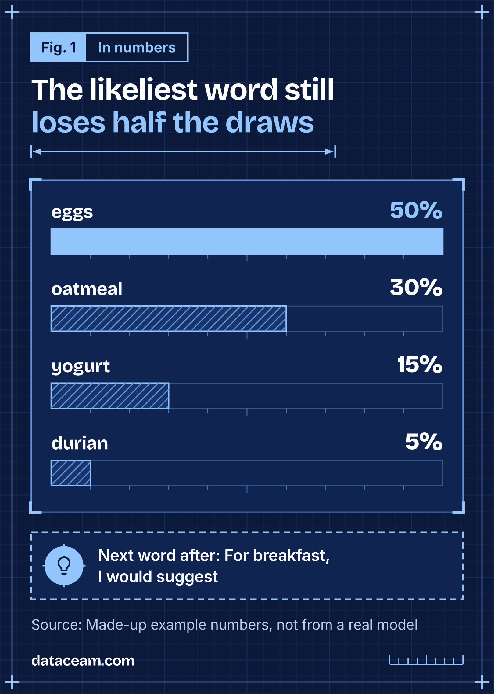
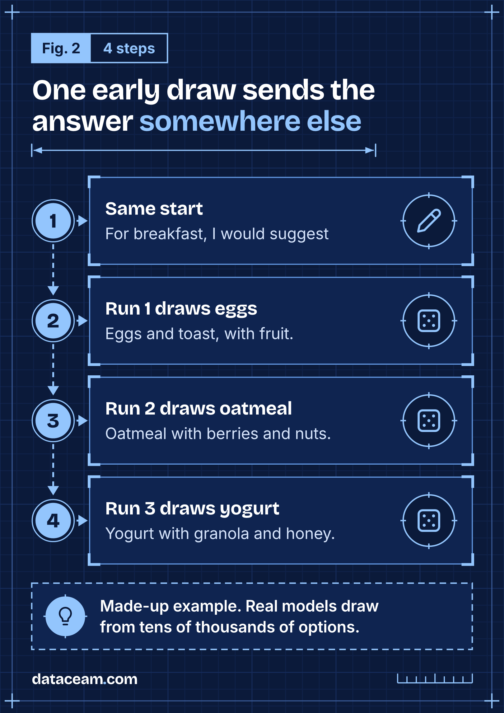
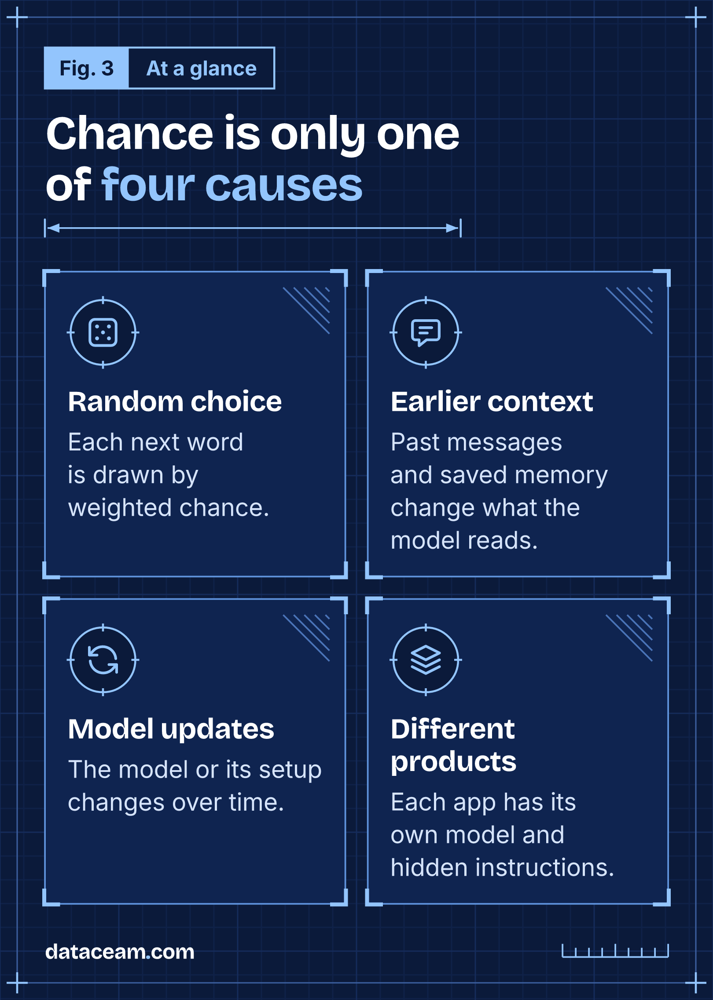

AI gives different answers to the same question because a chatbot doesn't look up one fixed reply. It writes its answer one small piece at a time, and at each step it picks the next piece with a bit of chance. Two runs can take different paths. Earlier messages, saved memory, hidden instructions and model updates can change the answer as well.

You may have seen this yourself. You ask for a product description, like it, close the tab, and ask again the next day. The second version is worded differently, and one of its facts has changed. That's not a glitch you caused. The differences have a handful of causes, and most of them you can steer.

## Why does AI give different answers to the same question?

A language model, which is a program trained on huge amounts of text to predict what comes next, doesn't store finished answers. It builds a reply in small chunks called [tokens](/guides/tokens/). Before each chunk, it scores every option, and the scores work like probabilities. Then it picks one, and the pick has chance in it. For a wider introduction, see [what a large language model is](/guides/what-is-an-llm/).

Think of a raffle. Each possible next word has a number of tickets in a drum. Common choices have many tickets and long shots have a few. The model draws one ticket, writes that word, refills the drum for the following word and draws again. Draw a different ticket early on and the sentence goes somewhere else.

The raffle is a picture, not a literal mechanism. Real models score tens of thousands of options or more at once, and the "tickets" are fractions, not whole tickets. But the logic holds: likely words win most draws, and unlikely ones still win now and then.

The exact odds are visible in some tools. OpenAI's [guide to log probabilities](https://developers.openai.com/cookbook/examples/using_logprobs) shows that a developer can ask a model for the probability of each token it chose. In one of its examples, the word "show" came out at about 56% after the phrase "My least favorite TV". Nothing forces the model to pick it.

> **In short:** A chatbot picks each next word by weighted chance. Different draws give different sentences, even from the same question.

## A worked example: one sentence start, three draws

Here is a made-up example with round numbers. The numbers are not from a real model. The start of the reply is "For breakfast, I would suggest". The model has four candidate next words, and we give them 100 tickets in total.

1. Eggs get 50 tickets, so a 50% chance.
2. Oatmeal gets 30 tickets, so 30%.
3. Yogurt gets 15 tickets, so 15%.
4. Durian gets 5 tickets, so 5%.

Check the sum: 50 + 30 + 15 + 5 = 100. Now the model draws. Run one draws "eggs" and goes on to write about eggs and toast. Run two draws "oatmeal" and writes about oats and berries. Run three draws "yogurt" and ends up on granola. Same question, same model, three different answers.

*Eggs is the most likely word, but it loses half of the draws. Durian is rare, yet it can still come up.*

Now let the model draw three times from that same drum.

*One early draw sets the direction. Every later word then builds on it.*

Once a word is drawn, later choices depend on it. That's why the answers can drift apart: the model doesn't go back and compare. It only continues from what it has already written.

## What is temperature in AI?

Temperature is a setting that controls how much chance goes into the draw. Anthropic's [glossary](https://platform.claude.com/docs/en/about-claude/glossary) says lower temperatures give "more conservative and deterministic outputs that stick to the most probable phrasing and answers," and higher ones give more varied output. In raffle terms, a low temperature takes tickets away from the long shots, so the favorite wins nearly every time.

Hugging Face's [explainer on decoding methods](https://huggingface.co/blog/how-to-generate) says the same thing: lowering the temperature makes likely words more dominant, and as it approaches zero, sampling behaves like always taking the top word (called greedy search). One common way to do this is to raise each probability to the power of 1 divided by the temperature (so squared at 0.5, to the fifth power at 0.2) and rescale so the total is 100% again. Using our breakfast numbers:

| Temperature | Eggs | Oatmeal | Yogurt | Durian |
|---|---|---|---|---|
| 1 (the odds as the model scored them) | 50.0% | 30.0% | 15.0% | 5.0% |
| 0.5 (lower, safer) | 68.5% | 24.7% | 6.2% | 0.7% |
| 0.2 (very low) | 92.6% | 7.2% | 0.2% | under 0.1% |

The arithmetic for 0.5: square each probability (0.5 becomes 0.25, 0.3 becomes 0.09, 0.15 becomes 0.0225, 0.05 becomes 0.0025), add them up to get 0.365, and divide each by it. Eggs: 0.25 / 0.365 = 68.5%. Real products may use other tricks as well, such as cutting off the unlikely tail of words, as in the "nucleus sampling" method from [Holtzman and colleagues](https://arxiv.org/abs/1904.09751). Their paper found that how you pick words can change the quality of the text a lot, even with the same model.

A higher temperature does the reverse. The long shots gain tickets, and the text becomes more varied and sometimes stranger.

> **In short:** Low temperature means safer, more repeatable text. High temperature means more variety, and more risk of odd choices.

## Can you make AI give the same answer every time?

Not with full certainty. In a chat app you usually can't change temperature at all, because the company sets it. Developers who use the API, which is the way programs talk to a model, can usually set temperature and often a "seed", a number that starts the chance in the same place each time.

Even then, exact repeats aren't promised. OpenAI's [seed guide](https://developers.openai.com/cookbook/examples/reproducible_outputs_with_the_seed_parameter) says the system makes "a best effort" to repeat results, and that fully deterministic output, meaning identical text every time, is not promised. Anthropic's glossary says that even with temperature at 0, results are not fully deterministic.

The main reason is how the servers do their math. A research team at Thinking Machines Lab [ran one question 1,000 times at temperature 0 on an open model](https://thinkingmachines.ai/blog/defeating-nondeterminism-in-llm-inference/). They got 80 different completions. The first 102 tokens were the same in all of them, and then the answers split. The authors trace this to how the servers handle many requests at once: the math is done in a slightly different order depending on how busy the server is, and tiny rounding differences can tip a close call. They fixed it in their own test, but it made the model slower.

For everyday use, the lesson is simple. Treat "identical every time" as something you can approach, not something you can order.

## Why does the same chatbot answer differently for different people?

Because the question isn't the only thing the model reads. The model also sees earlier messages in the chat, any files you added, hidden instructions from the app, and sometimes saved memory. Change any one of those and the answer can change, even if you type the same words.

Here are the usual suspects:

- **Earlier messages.** Everything said so far sits in the model's working space, its [context window](/guides/context-window/). A chat that started with "keep it formal" will answer differently from a fresh one.
- **Saved memory.** Some apps keep notes about you. OpenAI's [memory help page](https://help.openai.com/en/articles/8590148-memory-in-chatgpt) says ChatGPT can use saved memories and, when a setting is on, information from past chats to personalize replies.
- **Hidden instructions.** Apps usually add their own instructions before your message, called a system prompt, such as a role or a tone. You normally don't see them.
- **Web search and documents.** If the app fetches pages or files before answering, the answer depends on what it found that time. This is the idea behind [retrieval-augmented generation](/guides/rag/).

*The four main groups of causes. Web search results, listed above, also change what the model reads.*

## Why do two chatbots give different answers?

Because they are usually different products built on different models. Each company trains its model on its own mix of data and with its own methods, so the models learn different habits. [How a model is trained](/guides/training/) shapes what it finds likely, which is what fills the raffle drum.

On top of that, each app adds its own instructions, tools and safety rules. Two apps can also differ in whether they search the web. A comparison between two chatbots is therefore a comparison between whole systems, not just two sets of knowledge.

Models change over time too. OpenAI's seed guide describes a "system fingerprint", a value that tracks the backend setup behind a response, and says a change in it is a sign that outputs may differ. Companies update models and the systems around them, so an answer you got last month may not come back today. Apps rarely announce each change.

| Cause | What changes | Can you control it? |
|---|---|---|
| Random choice | Which word is drawn | Only partly, through settings in developer tools |
| Earlier messages and memory | What the model has read before your question | Yes: start a new chat, edit or switch off memory |
| Hidden instructions | The role and rules the app adds | Rarely |
| Model or backend updates | The model itself | No |
| Web search results | The facts the model is handed | Partly: ask it to use or skip search |

## Does a different answer mean the AI is wrong?

Not by itself. A different answer shows that the model has room in how it words things. It doesn't show which version is right. If two answers clash on a fact, at least one is wrong, but a confident tone won't tell you which.

OpenAI's logprobs guide makes a related point: a model's confidence measures how certain it is, not whether it is correct. A fluent sentence can still contain a made-up date or a wrong total. Calculations are a known weak spot of their own.

So if the facts matter, such as a legal deadline, a dose, a tax figure or a quote, check them against a primary source. If two runs disagree on a fact, that is useful: it tells you exactly which line to verify.

## When is variety useful, and when is it a problem?

Variety helps when you want options and hurts when you want one reliable result. Brainstorming names, rewording an awkward email or sketching ideas for a talk all benefit from a model that can surprise you. Asking again is a feature there.

It's a problem for accounting figures, policy wording, instructions that must match a rulebook and anything you plan to copy into a document unchecked. In those cases, you want the same steps and the same output shape each time, and you want a human to read the result.

## Common mistakes about different answers

- **"Different answers mean it's broken."** It's how these systems are designed. Choosing words with chance is what makes the text read naturally.
- **"One of the answers must be the real one."** Neither may be. The model isn't retrieving a stored fact the way a database does.
- **"Temperature 0 gives identical output."** It makes repeats much more likely, but the Thinking Machines test above still showed 80 versions in 1,000 runs.
- **"If I ask again, I'm checking it."** Asking the same model twice can repeat the same error. Use a second source.
- **"The chatbot is changing its mind to trick me."** It doesn't hold an opinion between runs. It just takes a different draw or reads a different context.

## How do you get more consistent answers from AI?

Give the model less room to wander. Anthropic's [consistency guide](https://platform.claude.com/docs/en/test-and-evaluate/strengthen-guardrails/increase-consistency) lists the main levers: say exactly what format you want, show an example of the output, ground the answer in a fixed set of information, and split big jobs into smaller steps. The guide is written for Claude, but the same ideas help with most chatbots.

Try this checklist next time:

1. **Fix the format.** "Answer in three bullet points, each under 15 words" beats "summarize this".
2. **Be specific.** Name the audience, the length and what to leave out.
3. **Paste the source text.** Hand the model the facts instead of leaving it to recall them.
4. **Keep the context the same.** Open a new chat for each test, and don't let earlier messages pull the answer sideways.
5. **Show one example** of the style you want.
6. **Ask for sources**, then open them. A source you can't open is a warning sign.
7. **Run it twice.** If two runs disagree on a fact, that fact needs checking.

If you build with the API, also lower the temperature and set a seed where the API offers one, and expect small differences to remain.

## Where to go next

If you want to see what the model actually reads, start with [tokens](/guides/tokens/) and the [context window](/guides/context-window/). To see why the odds themselves differ between models, read [how an AI model is trained](/guides/training/). More basics are on the [LLM basics topic page](/guides/topic/llm-basics/).
