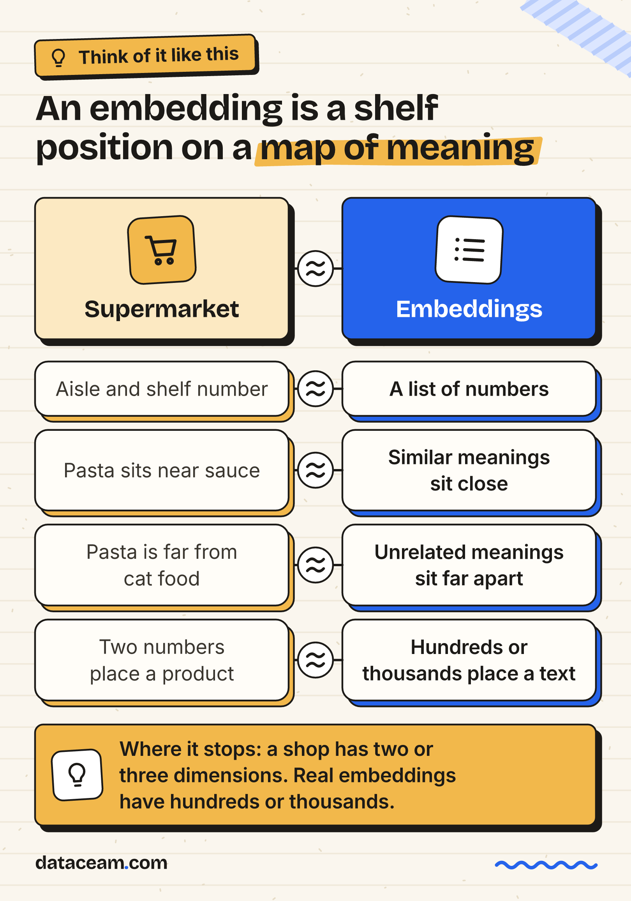
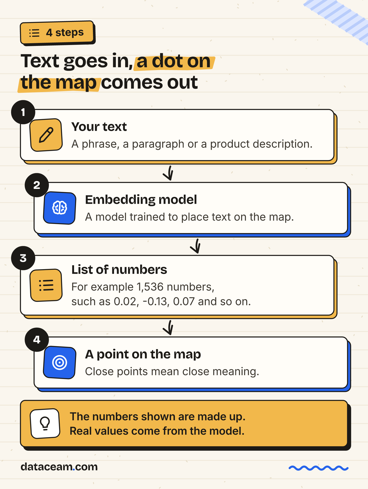
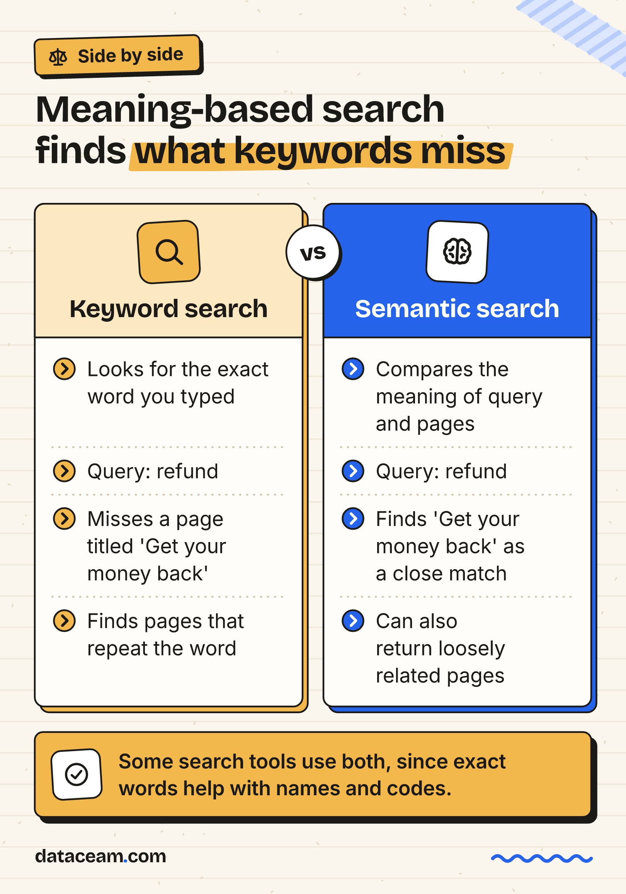

In AI, an embedding is a list of numbers that stands for the meaning of a piece of text, or of an image. It is made by an AI model so that things with similar meaning get similar lists. That lets a computer compare meaning by measuring how far apart two lists are. If you ask what embeddings are in AI, this is the whole idea: meaning turned into a position that software can measure.

You meet embeddings whenever a search box seems to understand you. You type "refund" and the help center shows its page called "Get your money back". No word matches, yet the right page appears. Embeddings are one common way that works.

## What are embeddings in AI? A supermarket map

An embedding is like a product's address in a supermarket: similar things get nearby addresses. Picture a supermarket. Every product has an address: an aisle number and a shelf. Pasta sits next to pasta sauce. Cat food sits next to dog biscuits, two aisles away from the pasta. If you want "something like spaghetti", you walk to the same spot and look at what is nearby.

An embedding works like that address, but for meaning. Each piece of text gets a position on a map, and similar meanings land close together. A **vector** is just the technical word for such a list of numbers: two numbers give a position on a flat map, three give a position in a room. A **vector embedding** is a vector that a model produced so its position reflects meaning. IBM describes it as representing objects such as text, images and audio as points on a smooth map with no fixed grid, where closer points are more similar ([IBM](https://www.ibm.com/think/topics/embedding)).

*Each row pairs a shop idea with its embedding twin. The last row shows where the shop picture runs out.*

The picture stops working in one place. A shop has two or three directions to move in. Real embeddings have hundreds or thousands, and nobody can draw that. Google's course also points out that the individual directions are rarely as easy to name as "sandwichness" or "dessertness", so you can't read an embedding like a shelf label.

> **In short:** An embedding is an address for meaning. Similar things get nearby addresses, and the computer finds matches by looking at what sits close.

### Why turn words into numbers?

A computer can't compare meanings, but it can compare numbers. Turn each text into a list of numbers, and "how alike are these two texts?" becomes "how far apart are these two lists?", which is simple arithmetic.

Spelling is no help here. "Refund" and "reimbursement" look quite different, while "refund" and "refine" start with the same three letters, yet the first pair mean almost the same thing and the second pair don't. A good embedding gives the first pair similar numbers and the second pair different ones.

The trick is that the numbers aren't chosen by hand. A model learns them from large amounts of text, so that words and phrases used in similar situations end up with similar numbers. Google's machine learning course describes this for word embeddings: words that appear in similar contexts end up near each other, so the vectors capture some of the relationships between meanings ([Google for Developers](https://developers.google.com/machine-learning/crash-course/embeddings/embedding-space)).

## A worked example on a two-number map

Here is a tiny map you can check yourself. We place five short phrases on a grid from 0 to 10. The positions are invented for teaching, not produced by a real model.

| Phrase | Position (across, up) |
|---|---|
| refund policy | (2, 8) |
| money back | (3, 9) |
| return an item | (3, 7) |
| cat food | (8, 2) |
| dog biscuits | (9, 3) |

Now measure straight-line distance, the way you would with a ruler. For two points, add up the squared gaps across and up, then take the square root.

1. Refund policy to money back: across gap 1, up gap 1. 1 + 1 = 2, and the square root of 2 is about 1.41.
2. Refund policy to return an item: gaps 1 and 1 again, so about 1.41.
3. Cat food to dog biscuits: gaps 1 and 1, so about 1.41.
4. Refund policy to cat food: gaps 6 and 6. 36 + 36 = 72, and the square root of 72 is about 8.49.
5. Money back to dog biscuits: gaps 6 and 6, so about 8.49.
6. Money back to return an item: across gap 0, up gap 2. 0 + 4 = 4, and the square root of 4 is 2.

The money phrases sit between about 1.4 and 2 apart. A money phrase and a pet phrase sit between about 7 and 8.5 apart, roughly four to six times farther. So if someone searches "money back", the closest points are "refund policy" and "return an item", and the pet phrases come last. The map "knows" nothing about shopping. It only holds positions, and the distances do the work.

A real model does the same with far more numbers. OpenAI's `text-embedding-3-small` returns 1,536 numbers by default and `text-embedding-3-large` returns 3,072 ([OpenAI](https://developers.openai.com/api/docs/guides/embeddings/)). A Hugging Face tutorial uses a small model that gives 384 numbers per sentence ([Hugging Face](https://huggingface.co/blog/getting-started-with-embeddings)). Voyage AI's current models, which Anthropic's docs point to, default to 1,024 or 2,048 ([Claude docs](https://platform.claude.com/docs/en/build-with-claude/embeddings)), and Google's Gemini embedding models default to 3,072 ([Gemini API docs](https://aistudio.google.com/docs/embeddings)). The distance idea is the same, just in many more directions.

| Model (as of November 2026) | Default length of the list |
|---|---|
| all-MiniLM-L6-v2 (Hugging Face example) | 384 |
| text-embedding-3-small (OpenAI) | 1,536 |
| text-embedding-3-large (OpenAI) | 3,072 |
| Gemini embedding models (Google) | 3,072 |

## How does a computer know two sentences mean the same thing?

It doesn't know it in the way you do. It turns both sentences into embeddings and checks that the lists are close. Close lists mean the model placed the sentences near each other, which usually happens when they're used in similar situations.

OpenAI's documentation puts it this way: small distances suggest high relatedness, and large distances suggest low relatedness. The usual measures are cosine similarity and the dot product. Both are short calculations that turn two lists into one closeness score. The Hugging Face tutorial uses cosine similarity to find which saved FAQ is closest to a user's question.

The model learns where to put things by practice on huge amounts of text, in a process like the one in [how an AI model is trained](/guides/training/). Mikolov and colleagues described efficient ways to learn word vectors in a [2013 paper](https://arxiv.org/abs/1301.3781), which tested the vectors on word-similarity tasks. Modern embedding models are much larger and handle whole sentences and paragraphs, but the goal is the same.

*Your question and every stored text go through the same model, so all their points share one map.*

## What is semantic search, and how is it different from keyword search?

Semantic search finds results by meaning. Keyword search finds results that contain the words you typed. **Semantic** just means "about meaning".

Say a store's help center has a page titled "How to get your money back". A shopper types "refund". A keyword search looks for the word "refund" and, if the page never uses it, shows nothing useful. Semantic search turns the query and every page into embeddings, then lists the pages whose points sit closest to the query. The money-back page comes up.

*Both columns use the same query. The only difference is whether the tool compares words or meaning.*

Semantic search has weak spots. Exact things such as a product code, a surname or a legal clause number may be better served by keyword search, since a code has no "meaning" to compare. Some search tools run both kinds of search and combine the results.

> **In short:** Keyword search asks "does this page contain my word?". Semantic search asks "does this page mean something close to my question?". Each is better at different jobs.

## Are embeddings the same as tokens?

No. A **token** is a small chunk of text, often a piece of a word, that a model reads in place of letters (see [what tokens are in AI](/guides/tokens/)). An embedding is the list of numbers that comes out at the end for the whole text. Embedding services usually take your text, count it in tokens, and return the lists.

| Term | What it is | Example |
|---|---|---|
| Token | A small chunk of text | "refund" or "re" + "fund" |
| Embedding | A list of numbers for the meaning of a text | 1,536 numbers for one sentence |
| Chat answer | New text a chat model writes | "You can return items within 30 days." |

Embeddings also differ from a chatbot's replies. A chat model, the kind explained in [what a large language model is](/guides/what-is-an-llm/), writes new text. An embedding model doesn't write anything. It only places text on the map. They are usually separate models: Anthropic's docs say it does not offer its own embedding model, and point developers to a separate provider.

## What are embeddings used for?

Anything that needs "find things like this one" can use them. OpenAI lists search, clustering, recommendations and anomaly detection among the uses, and IBM adds text and image search engines ([IBM](https://www.ibm.com/think/topics/embedding)).

- Search: rank pages or documents by closeness to the question, as in the refund example.
- Recommendations: suggest items whose embeddings sit near things a person liked.
- Grouping (clustering): put similar items into piles, such as sorting thousands of customer comments by topic.
- Spotting duplicates and odd ones out: two near-identical points are likely duplicates, and a point far from all the others may be unusual.
- Images and more: images, audio and video can be embedded too. Google's Gemini docs describe a model for text, images, video, audio and documents, and Hugging Face notes that sentence and image embeddings can be compared with each other.
- Feeding RAG: retrieval-augmented generation, or RAG, finds relevant passages first and hands them to a chat model. The original [2020 RAG paper](https://arxiv.org/abs/2005.11401) used a searchable store of embeddings for Wikipedia passages (the paper calls it a "dense vector index") for this lookup. Because only a few passages are passed on, they fit in the model's [context window](/guides/context-window/).

### What is a vector database?

A vector database is a store built to keep embeddings and quickly find the ones closest to a new embedding. You put in your documents' embeddings once, then ask "which stored points are nearest this question?". Google's Gemini docs link tutorials for third-party vector databases such as Chroma, Qdrant, Weaviate and Pinecone, which we name as examples only. Small collections can be searched without one. The Hugging Face tutorial keeps its 13 FAQ embeddings in an ordinary table.

## What embeddings can't do, and common myths

Embeddings measure similarity, and similar is not the same as true. A passage can be close to your question and still be wrong, out of date or about something else. The search returns the nearest points, whatever they say.

Embeddings from different models can't be mixed. Each model draws its own map, so the same sentence gets different numbers from each one. Google's Gemini docs state that the spaces of its two embedding models are incompatible, and that after switching you must re-embed all your existing data. Google's course adds that embeddings are usually specific to a task. The same foods could land in very different places depending on whether a model is sorting diets or suggesting meals.

Two practical points follow. Treat the result as a ranked guess and check the top matches. And before you embed a large collection, pick the model carefully, since changing later means doing the work again.

### Common mistakes and myths

- **"An embedding is a compressed copy of the text."** No. It's a position that keeps some of the meaning, not the words.
- **"Closer means correct."** Closer means more similar in the model's map. A close answer can still be false.
- **"Each number means something, like a topic."** Usually not. Google's course notes that single directions are rarely as readable as labels like "dessertness".
- **"Embeddings come from the chatbot."** They usually come from a separate embedding model.
- **"Any two embeddings can be compared."** Usually only if the same model made both. Different models draw different maps.

## Try it yourself

You can run your own test without any code. Open a help or search page that you use, and type a word, then a different word with the same meaning, such as "refund" and then "money back". If the results differ a lot, that site is probably leaning on keyword matching. If both bring up the same pages, it may be using meaning too, though this is only a hint, not proof.

If you'd like to go further, read [what a context window is](/guides/context-window/) to see why systems fetch only a few passages, browse [all guides](/guides/), or see more [guides on retrieval and RAG](/guides/topic/retrieval-rag/). To run an embedding model, the Hugging Face tutorial linked above is a good first project.
