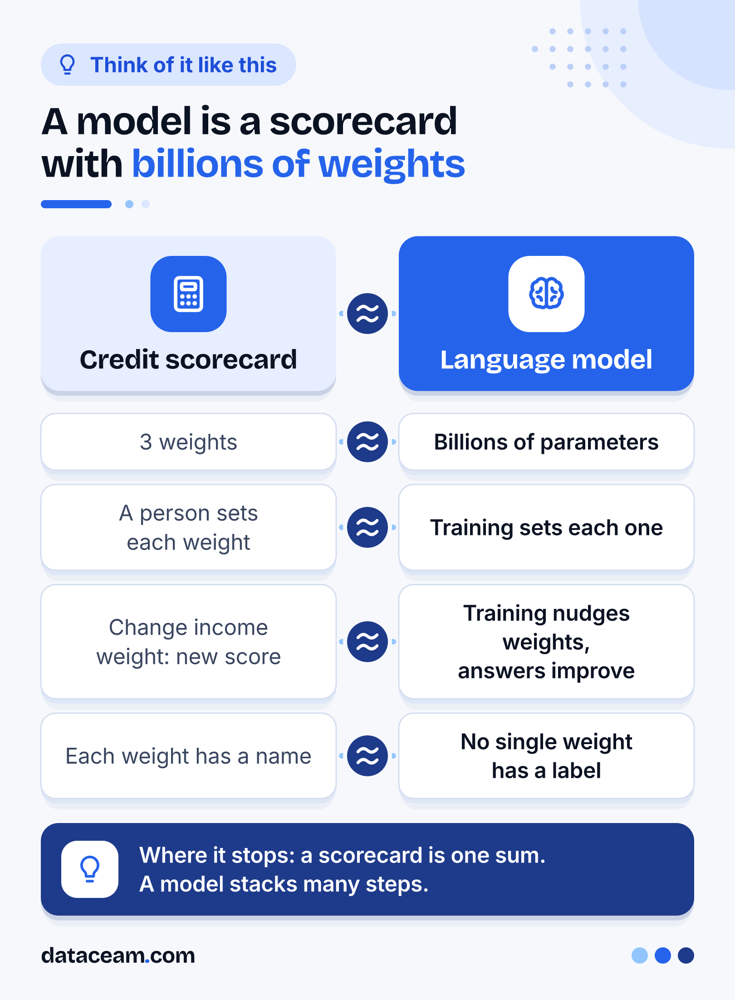
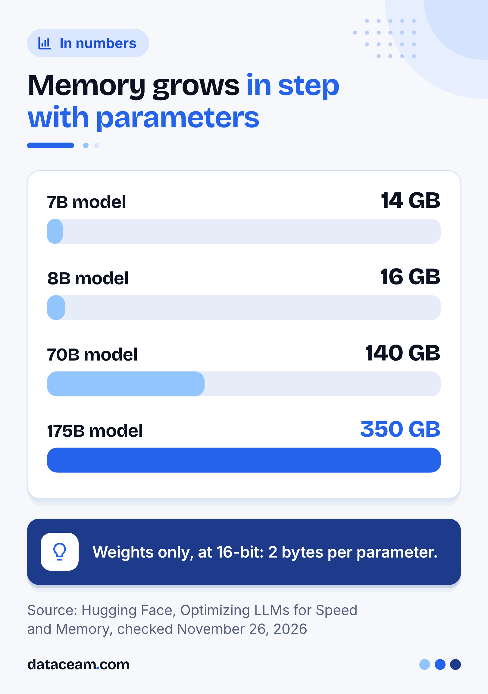
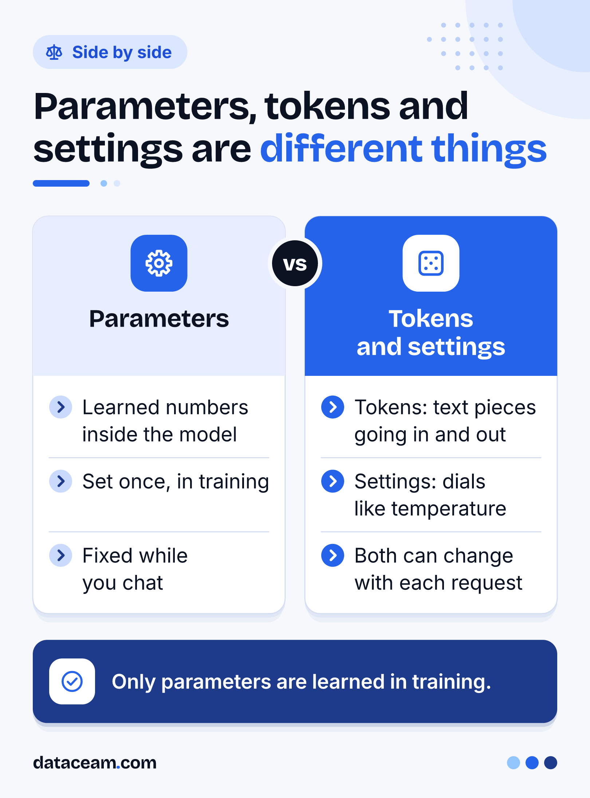

AI model parameters are the numbers a model adjusts while it is trained, and together they hold everything it has learned. When a model is called "7B", it has about 7 billion of them. Parameters stay fixed while you chat. They hold patterns learned from language rather than a list of saved sentences, and they decide how much computer memory the model needs.

You see these numbers whenever someone compares models or tries to run one at home. A label like "70B" sounds like a quality score, and it isn't. Knowing what it counts helps you read the news, pick a model, and spot claims that don't add up.

## What are AI model parameters?

A parameter is one number inside a model that was set during training. Most parameters are weights, which say how strongly one signal should count toward the next. IBM's explainer also lists biases, small constants that shift a result, and keeps hyperparameters (settings people choose rather than the model learning them, such as temperature) in a separate group. You can read IBM's definitions in [What are LLM parameters?](https://www.ibm.com/think/topics/llm-parameters).

A large language model (LLM) is a program that predicts the next piece of text. If that is new, start with [what an LLM is](/guides/what-is-an-llm/). Inside, the model is a very long chain of arithmetic. Parameters are the numbers that arithmetic multiplies and adds. Training starts with random values and nudges them, over and over, until the model's guesses improve. Afterward the values stay put while you chat. A developer can change them later with extra training, called fine-tuning, but an ordinary chat never does.

> **In short:** Parameters are the learned numbers inside a model. Training sets them. Chatting doesn't change them.

## How a scorecard explains parameters

A parameter works like a weight on a credit-risk scorecard, the kind a lender might use. Each factor gets a weight, and the score is the factors multiplied by their weights and added up. The weights are the "parameters" of the scorecard.

Here is a small one with three weights. Scores run on a 0 to 100 scale for each factor.

1. Payment history has weight 0.5. The applicant scores 80, so this adds 0.5 × 80 = 40.
2. Income has weight 0.3. The applicant scores 60, so this adds 0.3 × 60 = 18.
3. Debt load has weight -0.2 (a negative weight, because more debt lowers the score). The applicant scores 50, so this adds -0.2 × 50 = -10.
4. Add them up: 40 + 18 - 10 = 48.

Now suppose the lender finds that income predicts repayment better than they thought. They change the income weight from 0.3 to 0.4. The same applicant now gets 40 + 24 - 10 = 54. Nothing else changed, only one weight. That is the whole idea of training: tune the weights until the scores match reality.

An AI model works the same way, with two big differences. It has billions of weights, not three. And nobody picks them by hand. A training program adjusts them automatically, using huge amounts of text as the examples to match. The scorecard also gives one answer, while a model uses its weights in many stacked steps to choose each next piece of text. The comparison stops there. A scorecard weight has a clear meaning ("income"), but a single weight inside a model has no label you could read.

*A scorecard and a language model both work by weights. The model just has billions and no one names them.*

## What does 7B or 70B mean in an AI model name?

In a model name, B stands for billion, and the number counts parameters. A 7B model has about 7 billion, a 70B model about 70 billion. The size is often in the name so people can tell versions of the same model apart.

Here are some well-known sizes, each from the model's own paper or card. The sizes are fixed facts about those releases. What they say about quality is another matter.

| Model | Parameters | Year of paper or card | Source detail |
|---|---|---|---|
| GPT-3 (OpenAI) | 175 billion | 2020 | Named in the paper's abstract |
| Gopher (DeepMind) | 280 billion | 2021 | Compared in the Chinchilla paper |
| Chinchilla (DeepMind) | 70 billion | 2022 | Same compute as Gopher, 4 times more data |
| Llama 2 7B (Meta) | 7 billion | 2023 | Trained on 2.0 trillion tokens |
| Mixtral 8x7B (Mistral) | 47 billion total, 13 billion used per token | 2024 | Mixture of experts |
| Llama 3 8B (Meta) | 8 billion | 2024 | Trained on over 15 trillion tokens |
| Llama 3 largest (Meta) | 405 billion | 2024 | Named in the Llama 3 paper's abstract |

Sizes checked November 26, 2026. They come from [the GPT-3 paper](https://arxiv.org/abs/2005.14165), [the Llama 3 paper](https://arxiv.org/abs/2407.21783), [the Chinchilla paper](https://arxiv.org/abs/2203.15556), [Meta's Llama 2 7B card](https://huggingface.co/meta-llama/Llama-2-7b), [Meta's Llama 3 8B card](https://huggingface.co/meta-llama/Meta-Llama-3-8B) and [the Mixtral paper](https://arxiv.org/abs/2401.04088). Companies often don't publish the size of their newest chat models, so be wary of any exact figure for them.

### How many parameters do popular chatbots have?

Many companies don't publish the size of their current chatbot models. The table above lists models whose makers or researchers published the size. For others, any number you see online is an estimate or a rumor.

That is a good reason to treat a parameter count as one piece of information. It tells you roughly how big a model is. It does not tell you how it was trained, what data it saw or how well it answers your questions.

## How much memory does a 7B model need?

At the usual 16-bit precision, a model needs about 2 bytes per parameter, so a 7B model needs about 14 GB just to load its weights. A byte is a small unit of computer storage, and a gigabyte (GB) is a billion of them. The rule comes from Hugging Face's guide [Optimizing LLMs for speed and memory](https://huggingface.co/docs/transformers/main/en/llm_tutorial_optimization): loading X billion parameters in 16-bit needs roughly 2 × X GB of video memory (VRAM), the fast memory on a graphics card.

Here is the sum, step by step.

1. Take the parameter count: 7 billion.
2. Pick the number of bytes per parameter. A bit is a single 0 or 1, and a byte is 8 bits, so a 16-bit number takes 16 ÷ 8 = 2 bytes.
3. Multiply: 7 billion × 2 bytes = 14 billion bytes, or about 14 GB.

The same sum for other sizes: an 8B model needs about 16 GB, a 70B model about 140 GB, and GPT-3 at 175B about 350 GB, the figure Hugging Face gives. These numbers cover only the weights. Running the model needs extra memory for the conversation itself, which grows with the [context window](/guides/context-window/) you use.

*Memory grows in step with size. This is why big models run on clusters of special chips, not on a laptop.*

> **In short:** Memory for the weights is parameters × bytes per parameter. At 16-bit, that is 2 GB for every billion parameters.

### What is quantization and why does it shrink models?

Quantization stores each parameter with fewer bits, so the model takes less memory. Hugging Face's [quantization overview](https://huggingface.co/docs/transformers/main/en/quantization/overview) gives an example: an 8B model needs about 16 GB in 16-bit form, about 8 GB at 8 bits and about 4 to 5 GB at 4 bits.

Think of rounding prices. Writing $19.99 as $20 saves space and loses a little detail. Quantization does the same to the model's numbers. The sum is the same as before: 70 billion × 0.5 bytes (4 bits is half a byte) = 35 GB, down from 140 GB.

The trade-off is accuracy. The same page says fewer bits cost some accuracy, and each method balances memory, speed and accuracy differently. The Hugging Face optimization guide adds that quantized models are often not faster, and can be a little slower. It also reports that in its own test, 4-bit output was almost the same as full precision, but notes results can differ from case to case. Try it on your own task before relying on it.

| Precision | Bytes per parameter | 7B model | 70B model |
|---|---|---|---|
| 16-bit | 2 | 14 GB | 140 GB |
| 8-bit | 1 | 7 GB | 70 GB |
| 4-bit | 0.5 | 3.5 GB | 35 GB |

*Weights only, worked out as parameters × bytes.*

## Does a model with more parameters always work better?

No. More parameters often help, but the amount of training data matters too. The 2020 study [Scaling Laws for Neural Language Models](https://arxiv.org/abs/2001.08361) found that a model's error falls in a steady pattern as model size, data and computing power grow. For a fixed budget, it concluded that very large models on a modest amount of data were the most efficient choice.

Two years later, [the Chinchilla paper](https://arxiv.org/abs/2203.15556) from DeepMind revised that advice. It found that model size and training data should grow at the same rate: double one, and you should double the other. Their 70B Chinchilla used the same compute budget as the 280B Gopher but four times more data. It outperformed Gopher, GPT-3 and two other larger models on a wide range of tests. The authors also note a lower cost to run it, since it is smaller.

Recent releases follow that lesson. Meta's Llama 2 7B saw 2.0 trillion tokens, and its Llama 3 8B saw over 15 trillion. The newer model has a similar size and read more than seven times as much text. (Tokens are pieces of text, covered in [our guide to tokens](/guides/tokens/).)

So a parameter count is a size label, like engine displacement on a car. A bigger engine can go faster, but design and fuel quality matter as well.

### Some models use only part of their parameters

A mixture of experts (MoE) model splits its parameters into groups called experts, and for each piece of text it uses only a few of them. Mixtral 8x7B has 8 experts at each stage of its calculation (each layer), and a small built-in chooser, called a router, picks 2 of them for every token. Its paper says each token has access to 47 billion parameters but uses only 13 billion. So the total size sets the memory you need, while the active part sets how much work happens per word.

## What is the difference between parameters, tokens and settings?

Parameters are the learned numbers inside the model. Tokens are the text going in and out. Settings, such as temperature, are dials you or the app choose for each answer. People mix them up because all three come in numbers.

*Only parameters are learned and kept in the model. Your text and your settings can change with every request.*

IBM puts settings like temperature under hyperparameters, which are set outside the model rather than learned. [Temperature](/guides/different-answers/) changes how adventurous the next-word choice is. It does not change the model's weights. The context window is another limit, and it is not a parameter either: it is how many tokens fit in one request.

## Common mistakes about model size

- **"More parameters means smarter."** Size is one factor. Training data, how long the model was trained and how it was tuned afterward all count. Chinchilla beat a model four times its size.
- **"A bigger number means a newer model."** Not necessarily. GPT-3 from 2020 has 175 billion, while Llama 3 8B from 2024 has 8 billion.
- **"Parameters are facts the model stores."** They hold patterns, spread across billions of numbers. You can't point to one number and say it holds one fact.
- **"Temperature is a parameter you can edit in the model."** It is a setting applied when the answer is made. The weights stay the same.
- **"A 70B model fits on any good computer."** At 16-bit it needs about 140 GB for the weights alone. Quantization helps, but it has a cost in accuracy.

## Check a model's size yourself

Open a model's page on Hugging Face, or a company's model card, and look for the parameter count. Then do three small checks:

1. Multiply the count in billions by 2 to get the 16-bit memory in GB.
2. Divide that by 2 for 8-bit, or by 4 for 4-bit.
3. Compare the result with your computer's memory, or with the memory on your graphics card if you have one.

If you want more, read [how an LLM works](/guides/what-is-an-llm/), how [tokens](/guides/tokens/) set cost and limits, or the [context window](/guides/context-window/) guide. More are on the [LLM basics page](/guides/topic/llm-basics/).
