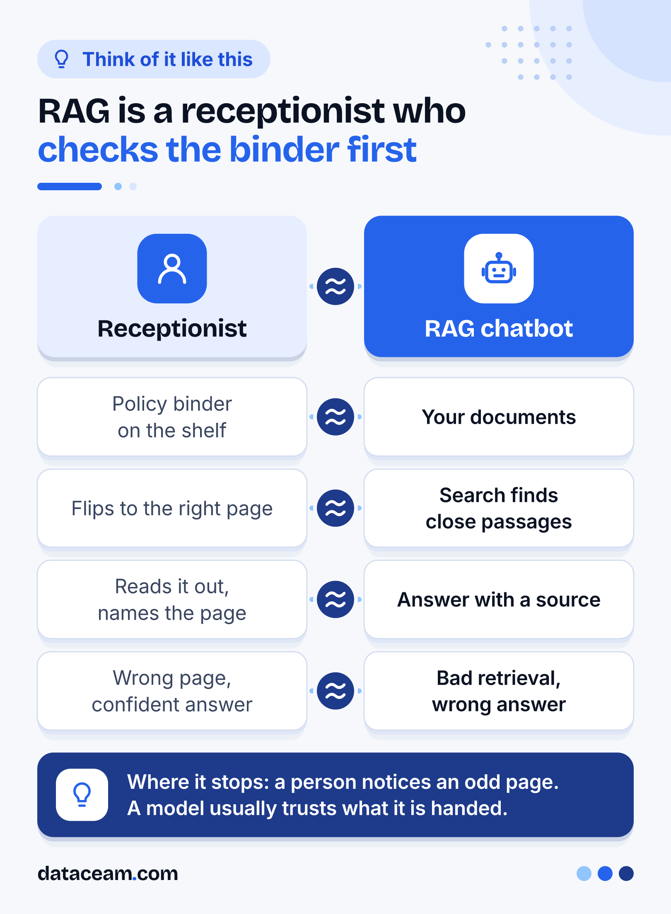
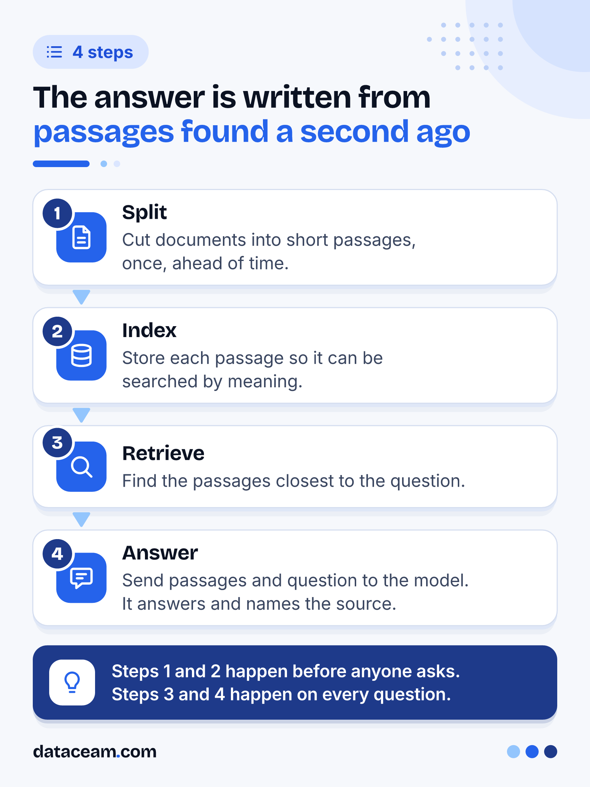
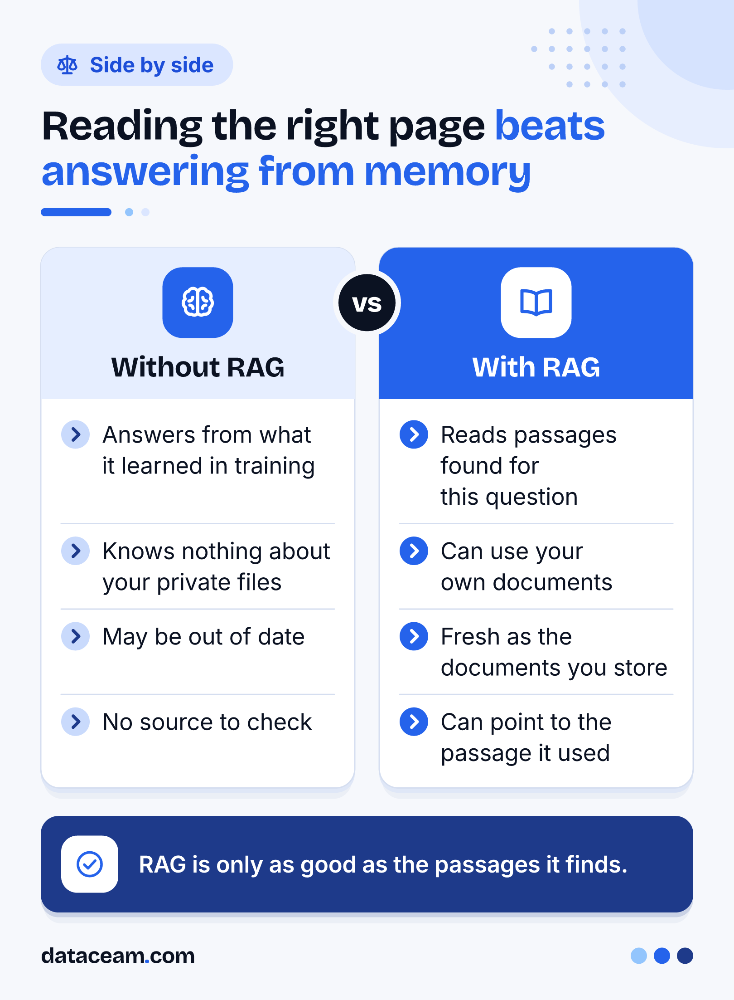

RAG in AI stands for retrieval-augmented generation: a way of making an AI chatbot look up relevant text first and then answer using what it found. The short version is retrieve, then generate. The model is no longer answering only from memory. It answers with the pages its search found open in front of it, and the answer is only as good as those pages.

You often meet RAG when a company chatbot answers a question about its own rules, such as a return policy or a leave request, and points to the page it used. Knowing how it works helps you judge when to trust that answer and when to check it.

## What is RAG in AI? A receptionist with a policy binder

RAG works like a receptionist who, asked about the company's rules, flips to the right page of the policy binder and reads it out, naming the page. A receptionist who answers from memory might get it right, or might be a year out of date. One who checks the binder first is much more likely to be correct, and you can ask which page they read.

In a RAG system, the binder is a collection of documents. The receptionist is an AI model, the kind explained in [what a large language model is](/guides/what-is-an-llm/). The page-flipping is a search step that runs before the model writes anything.

*The last row is where the picture matters most: a wrong page leads to a confident wrong answer.*

The comparison breaks down in one place. A human receptionist notices when a page looks odd or doesn't fit the question. A model usually treats whatever it is handed as the material to answer from.

The idea comes from a 2020 research paper by Patrick Lewis and colleagues. IBM Research credits Meta, then called Facebook, with introducing it ([IBM Research](https://research.ibm.com/blog/retrieval-augmented-generation-RAG)). The paper combined a language model, which holds what it learned in training, with a searchable index of Wikipedia passages that the model could consult. The authors reported that this beat models that relied on their memory alone on three question-answering tests that draw on general knowledge ([Lewis et al. 2020](https://arxiv.org/abs/2005.11401)). NVIDIA's explainer adds that the lead author has said he wished the team had picked a better name ([NVIDIA](https://blogs.nvidia.com/blog/what-is-retrieval-augmented-generation/)).

> **In short:** RAG means "look it up, then answer". The look-up happens in your documents, and the answer is written from what was found.

## How does retrieval-augmented generation work, step by step?

It works in four steps: split your documents into passages, index the passages, retrieve the ones closest to a question, then give them and the question to the model. The first two steps are done once, ahead of time. The last two run every time someone asks.

1. **Split.** Documents are cut into passages, often called chunks. [Anthropic](https://www.anthropic.com/news/contextual-retrieval) describes chunks as usually no more than a few hundred tokens. A token is a small piece of text, often part of a word (see [what tokens are](/guides/tokens/)).
2. **Index.** Each passage is turned into an embedding, a list of numbers that stands for its meaning, and stored in a searchable index. [AWS](https://aws.amazon.com/what-is/retrieval-augmented-generation/) describes this as converting the data into numerical vectors kept in a vector database. [What embeddings are](/guides/embeddings/) covers how that works.
3. **Retrieve.** The question gets the same treatment. The system compares its numbers with those of the stored passages and picks the closest few. This is what "closest" means: nearest in meaning, even when the words differ. Some systems also run a keyword search alongside, as Anthropic's post describes.
4. **Answer.** The chosen passages are pasted into the prompt, the text the model reads, next to the question. The model writes its reply from them, and the system can show which passages it used.

*Steps 1 and 2 are preparation. Steps 3 and 4 repeat for every question.*

Behind the scenes, the index has to be refreshed as documents change. [AWS notes](https://aws.amazon.com/what-is/retrieval-augmented-generation/) that the stored data needs updating, either in real time or in batches, so the answers stay current.

## A worked example: a holiday-policy question

This is an invented example. The company, handbook and numbers are made up to show the steps.

Say a company has a 3,000-word staff handbook, and an employee asks: "How many paid vacation days do I get after three years?"

1. **Split.** The handbook is cut into passages of about 200 words each. 3,000 divided by 200 gives 15 passages.
2. **Index.** Each of the 15 passages becomes a list of numbers and goes into the index. This was done last week, before the question.
3. **Retrieve.** The question becomes a list of numbers too. The system finds the two passages nearest to it. Say they are "Paid time off" (the rules for days earned each year of service) and "Carrying over unused days".
4. **Answer.** The system builds a prompt: an instruction ("answer only from these passages and name the one you used"), the two passages, and the question. Two passages of about 200 words is 400 words, a small fraction of what a model can read at once (see [what a context window is](/guides/context-window/)). The model replies: "After three years you get 20 days, according to the Paid time off section."

The number 20 comes from the invented handbook. The point is the order of events: the answer was read from a passage found a moment earlier, not recalled from training. A model that had never seen this company's handbook could not have produced that answer, and the reply names where to check it.

> **In short:** The model never reads the whole handbook. A search step picks a few passages, and the model reads only those.

## Why use RAG instead of just asking the model?

RAG lets a model answer from your documents and from newer information than it was trained on, with sources you can check and no retraining. A model on its own knows only what was in its training data, which stops at a cutoff date and excludes your private files. How training works is covered in [how an AI model is trained](/guides/training/).

[AWS lists several benefits](https://aws.amazon.com/what-is/retrieval-augmented-generation/): it costs less than retraining a model on new information, it can draw on fresh sources, answers can cite where they came from, and developers can control which sources are used and fix a bad one. [IBM Research](https://research.ibm.com/blog/retrieval-augmented-generation-RAG) adds a point about trust: users can cross-check an answer against the original content.

*Both columns start with the same question. Only the second gives the model a page to read.*

There is also a plain alternative for small collections. In a September 2024 post, [Anthropic says](https://www.anthropic.com/news/contextual-retrieval) that if your knowledge base is under 200,000 tokens, about 500 pages, you can put all of it in the prompt and skip RAG. That depends on how much text your model can read at once. Larger collections need a search step like RAG.

| Question | Asking the model alone | RAG |
|---|---|---|
| Can it use your private files? | No, unless you paste them in | Yes, if they are in the index |
| How fresh is it? | As of its training cutoff | As fresh as the stored documents |
| Can it show a source? | Not reliably | Usually, the passages it was given |
| Does the model change? | No | No |

## Can RAG really prevent made-up answers?

No. RAG lowers the chance of made-up answers, but it doesn't remove it. [IBM Research says](https://research.ibm.com/blog/retrieval-augmented-generation-RAG) RAG reduces hallucinations, meaning wrong or misleading output, by grounding the model in outside facts, and in the same article calls it imperfect, with open problems in both finding the right information and using it well.

The model only sees what the search hands over. If the search returns the wrong passage, the model writes a fluent, confident answer from it. Nothing in the process tells the model the passage is off-topic. [OpenAI's optimization guide](https://developers.openai.com/api/docs/guides/optimizing-llm-accuracy/) says wrong or excess context can cause hallucinations, and that RAG adds a retrieval step you have to tune.

### How does a wrong answer happen?

Here is the failure case for the invented handbook. Suppose it has two passages that both mention days off: "Paid time off" (vacation days earned by years of service) and "Company holidays" (the days the office closes each year, such as national holidays).

The employee asks a slightly different question: "How many holidays do I get after three years?" The search compares meaning, and "holidays" sits close to the "Company holidays" passage. That passage lists 11 office-closure days and says nothing about length of service. The system hands it over, and the model replies, with the passage name as its source: "You get 11 holidays."

The answer is fluent, cites a real page, and is wrong for what the employee meant. Nothing broke in the program. The search found something similar rather than something right.

There are other causes too. [Anthropic's contextual retrieval post](https://www.anthropic.com/news/contextual-retrieval) points out that splitting a document can strip a passage of its context. Its example is a chunk saying a company's revenue "grew by 3%" without naming the company or the period. In Anthropic's own test, the plain method failed to find the right chunk in the top 20 results 5.7% of the time, and the company's fixes cut that to 2.9% or lower. That is their test on their data, so treat the numbers as an illustration, not a forecast for your case.

Long prompts bring another risk. A 2023 study found that models often do best when the key information is at the beginning or end of the input, and worse when it sits in the middle ([Liu et al. 2023](https://arxiv.org/abs/2307.03172)). Stuffing in many passages can bury the one that matters.

### Common mistakes and myths

- **"RAG means the AI is always right."** No. It is only as good as the passages found and the way the model reads them.
- **"A cited source means the answer is correct."** A source shows where the answer came from. It doesn't prove the passage was the right one. Open it and read.
- **"RAG teaches the model your documents."** The model itself doesn't change. The text is handed over for each question and then forgotten.
- **"More passages are always better."** Extra passages can add noise and bury the useful one, as the "lost in the middle" study suggests.
- **"RAG makes old documents current."** It's only as fresh as the documents in the index. If nobody updates them, the answers go stale.

## What is the difference between RAG and fine-tuning?

RAG gives the model new material to read when the question arrives. Fine-tuning changes the model itself, by training it more on examples. [OpenAI's guide](https://developers.openai.com/api/docs/guides/optimizing-llm-accuracy/) puts it as two kinds of problem: a context problem (the model lacks knowledge, has outdated knowledge, or needs private information), where RAG helps, and a behavior problem (consistent tone, format or reasoning), where fine-tuning helps.

| Method | What it changes | Good for | Main limit |
|---|---|---|---|
| Prompting | The instructions you write | Most tasks, as a first try | Long prompts get unwieldy |
| RAG | What the model reads per question | Private or fresh knowledge | Only as good as the search |
| Fine-tuning | The model's learned behavior | Style, format, consistency | Needs good examples; changes need retraining |

These three can be combined. OpenAI's guide suggests starting with a simple prompt, testing it, and then picking the method that fixes the problem you see, rather than always going in the same order. Picking between them for a real project takes more room than this guide has. For a first idea: if the model is missing facts, think RAG. If it has the facts but writes in the wrong way, think fine-tuning.

## What do you need to build a RAG system, and what data can it use?

You need documents, a way to split and index them, a search step, and a model to write the answer. Hosted services can do the first three for you: [OpenAI's retrieval documentation](https://developers.openai.com/api/docs/guides/retrieval/) describes uploading files and having them split, embedded and indexed automatically, with results returned together with the source file name.

The data can be most kinds of text. [AWS lists](https://aws.amazon.com/what-is/retrieval-augmented-generation/) manuals, FAQs, research reports, HR documents and database records. [NVIDIA adds](https://blogs.nvidia.com/blog/what-is-retrieval-augmented-generation/) policy manuals, logs and private files such as emails and notes. Tools differ in the formats they accept; OpenAI's list includes PDF, Word, PowerPoint, Markdown, HTML and plain text. Typical uses are help centers that answer from support articles, internal assistants that answer from company policies, and question-answering over a pile of contracts or reports.

Some limits are set by the tool, so check the current page of whichever one you use. As of November 2026, OpenAI's documentation lists a default maximum chunk size of 800 tokens, up to 10 results per search by default (50 at most), and a maximum file size of 512 MB.

Agents, which are AI systems that take several steps on their own, often treat search as one of several tools. And retrieved documents can contain hidden instructions aimed at the model, a trick called prompt injection, so retrieved text is not automatically safe.

## How to check a RAG product, and what to read next

You can judge a chatbot that claims to answer from documents with a few plain questions.

1. **Where do the documents come from?** Official, owned by the company, or scraped from anywhere?
2. **How fresh are they?** When was the index last updated, and what happens when a policy changes?
3. **Does it show its sources?** Can you open the passage behind each answer?
4. **What does it do when it finds nothing?** A good system says it doesn't know instead of answering anyway.
5. **Who can see which documents?** AWS notes that developers can limit access by user permissions. Ask whether that is switched on.

Then run a test. Ask a question you already know the answer to, then a trick version with a similar word, like the holiday example above. Open the cited source each time. If the source and the answer disagree, you have learned something about the product.

To see how "closest passage" is measured, read [what embeddings are](/guides/embeddings/). To see why only a few passages fit in a prompt, read [what a context window is](/guides/context-window/). For the bigger picture of how the model underneath works, there is [what a large language model is](/guides/what-is-an-llm/), and you can browse [all guides](/guides/) or the [guides on retrieval and RAG](/guides/topic/retrieval-rag/).
