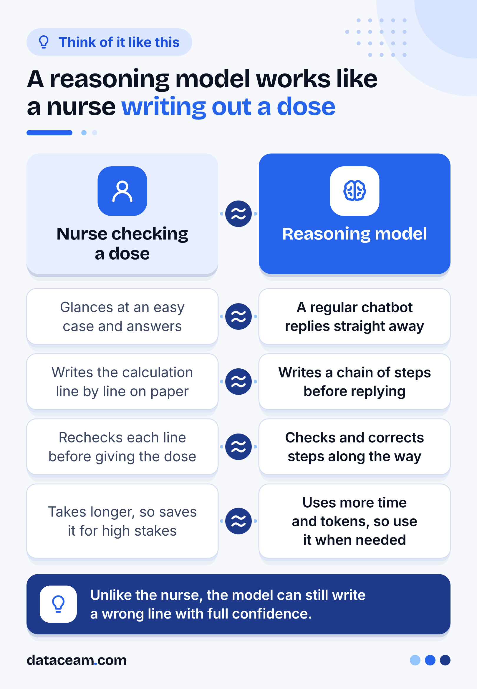
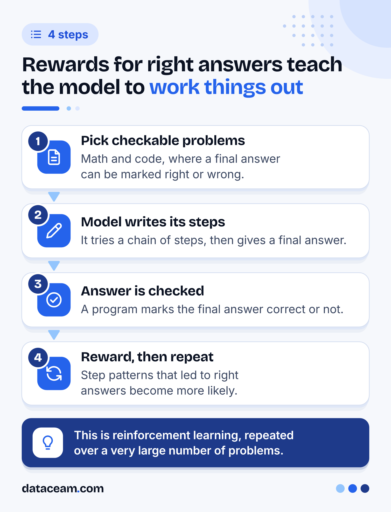
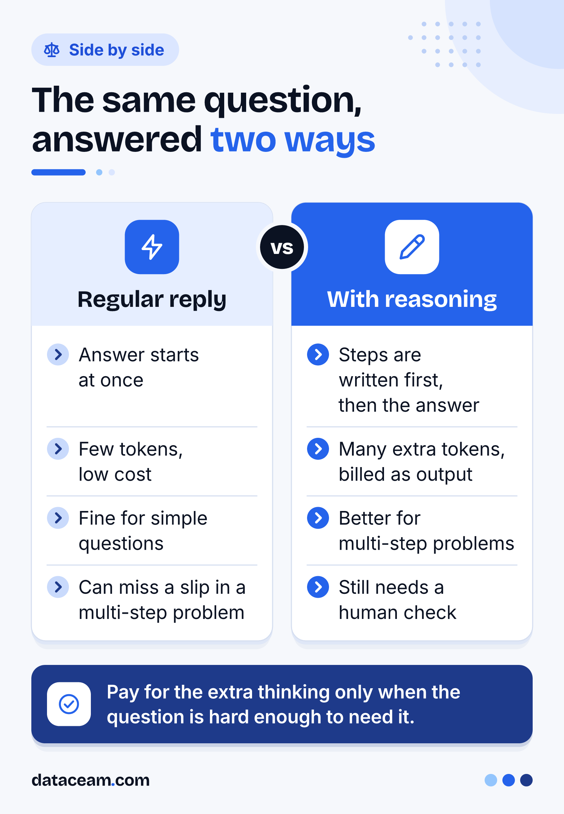
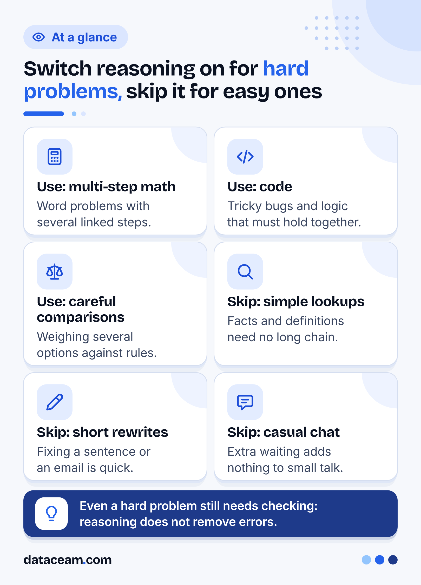

Reasoning models are AI models that work through a problem in steps before they answer. They write out a long chain of reasoning first, often hidden from you, and only then give the final reply. That extra writing usually helps on math, code and planning problems. It also makes the model slower and more expensive than a regular chatbot, and it does not make the answer certain.

This matters the moment you see a "thinking" button or a model picker in your chat app. Do you switch it on for a tax question, a spreadsheet formula, a short email? The honest answer is "sometimes", and this guide shows you how to tell which times.

## What are reasoning models in AI?

A reasoning model is a [large language model](/guides/what-is-an-llm/) that has been trained to write out a long chain of steps before its final answer. OpenAI described its first such model, o1, in September 2024 as one that [produces a long internal chain of thought before responding](https://openai.com/index/learning-to-reason-with-llms/). Since then other labs have released their own. DeepSeek published DeepSeek-R1, and [Anthropic's Claude](https://platform.claude.com/docs/en/build-with-claude/thinking) and [Google's Gemini](https://aistudio.google.com/docs/thinking) have thinking features of their own.

Think of a nurse checking a drug dose. For an easy case, a glance is usually enough and usually right. For a high-stakes calculation, the nurse writes the working out on paper and checks each line. A regular chatbot is the glance. A reasoning model is the paper.

*The paper slows the nurse down, which is why it is kept for cases where a slip would be costly.*

The comparison stops in one place. A nurse knows when a line looks wrong. A model can write a wrong line in the same calm tone as a right one, so the paper helps, but it doesn't make the answer safe.

You may also see the term large reasoning models, or LRMs. It means the same thing: a large language model with this step-by-step habit built in.

> **In short:** A reasoning model writes out its working before it answers. It is a regular language model that was trained to do this on purpose.

### How are reasoning models different from regular chatbots?

The main difference is what happens between your question and the reply. A regular chatbot starts writing its answer at once. A reasoning model first writes a stretch of working, which can run to many thousands of tokens, and then writes the answer.

Both kinds write text one small piece at a time. The new part is that the reasoning model has been trained to use the first stretch as scratch paper. In [the OpenAI documentation](https://developers.openai.com/api/docs/guides/reasoning/), these pieces are called reasoning tokens. A token is a small chunk of text, often part of a word. [The guide to tokens](/guides/tokens/) explains how text is cut up.

The table compares them in everyday use.

| | Regular chatbot | Reasoning model |
|---|---|---|
| What happens first | Starts the answer at once | Writes steps, then answers |
| Speed | Fast | Slower, because it writes more first |
| Cost per question | Lower | Higher, because of the extra tokens |
| Good at | Quick answers, rewrites, chat | Multi-step math, code, planning |
| Can you see the steps? | Not applicable | Often only a summary |

Some products now blur this line. A chat app may decide for you how long to think, or give you a setting. OpenAI's documentation says its models accept a "reasoning effort" setting, with values that depend on the model, and that [lower effort favors speed and lower token usage](https://developers.openai.com/api/docs/guides/reasoning/). Names and options change often, so check what your own app offers.

## How do reasoning models learn to reason?

### What is chain of thought?

Chain of thought means writing out the middle steps between a question and its answer. The idea came first as a prompting trick. In 2022, Google researchers showed a model a few examples that included worked steps, and the model then wrote steps of its own. [This improved its results on math, common-sense and symbolic problems](https://arxiv.org/abs/2201.11903). A very large model, with 540 billion [parameters](/guides/parameters/) (the numbers a model learns during training), reached a top score at the time on a school-level math test called GSM8K.

The trick works because a short step is less likely to slip than a long leap. And the steps stay on the page, so the model can read them as it writes the next one. [The guide on why AI is bad at math](/guides/bad-at-maths/) shows what goes wrong when a chatbot jumps straight to a number.

Reasoning models took that trick and built it in. You no longer have to write "show your steps" in the prompt. The model has learned to do it, and to do much more of it, on its own.

> **In short:** Chain of thought started as a way to ask for steps. Reasoning models were trained to produce the steps without being asked.

### How does training with rewards work?

They are trained with reinforcement learning, a method where the model tries things and is rewarded when the outcome is good. OpenAI says its [large-scale reinforcement learning algorithm teaches the model how to use its chain of thought](https://openai.com/index/learning-to-reason-with-llms/) productively. It adds that the model learns to recognize and correct its mistakes and to try a different approach when one isn't working.

The key is choosing problems whose answers can be checked by a program. Math and code are the standard cases. The DeepSeek-R1 paper focuses on [verifiable tasks such as mathematics and coding](https://arxiv.org/abs/2501.12948). The authors report that reasoning can be encouraged through pure reinforcement learning, without human-labeled examples of reasoning steps, and that behaviors such as self-reflection and verification appeared along the way.

The loop, simplified, looks like this.

*The model is rewarded for the final answer being right, so step patterns that lead there become more likely.*

This sits on top of the usual stages in [how an AI model is trained](/guides/training/). It is an extra round of practice, with a marking scheme that a computer can apply. That also explains why these models shine most on math and code. Those are the places where "right" is easy to check during training. Where there is no clean answer key, such as writing a kind letter, the method has less to hold on to.

A 2024 study adds a limit. It found that a smaller model given extra computing time while answering [could beat a model 14 times larger](https://arxiv.org/abs/2408.03314), with the same total computing budget. But this only held on problems the smaller model could already solve some of the time. So thinking longer is no cure-all. It helps most when the model is already partway there.

## A worked example: one question, two replies

Here is a small word problem. A shop sells pens at $3 each, or a pack of 4 for $10. What is the lowest price for exactly 11 pens? The right answer is $29. The "fast" reply below is invented to show a typical slip. It is not a recorded result from any product.

1. A fast reply says: "11 pens at $3 is $33." It is fluent and short, and it ignores the pack deal. It is a valid price, but not the lowest.
2. A reasoning model starts by splitting the job. A pack holds 4 pens, so 11 pens could be two packs (8 pens) plus 3 single pens.
3. It prices that option. Two packs cost 2 × $10 = $20. Three singles cost 3 × $3 = $9. The total is $20 + $9 = $29.
4. It checks other options. One pack plus 7 singles costs $10 + (7 × $3) = $10 + $21 = $31. All singles cost 11 × $3 = $33.
5. It compares the three totals ($29, $31, $33) and answers: "$29, using two packs and three single pens."

Step 4 is the habit that matters. The model looks at alternatives and compares them, and a regular reply often skips this. The cost is that all of steps 2 to 5 were written as tokens before you saw the answer.

*The extra steps are what you pay for, in waiting time and in tokens.*

## Why are reasoning models slower and more expensive?

They are slower and cost more because the thinking is made of tokens, and tokens take time to write and are billed. OpenAI, Anthropic and Google all say you are charged for thinking even if you never see it. OpenAI says reasoning tokens [take up space in the context window and are billed as output tokens](https://developers.openai.com/api/docs/guides/reasoning/). The context window is the amount of text a model can hold at once.

Anthropic says its thinking tokens [are billed as output tokens, even when the thinking text isn't returned](https://platform.claude.com/docs/en/build-with-claude/thinking). Google says pricing is [based on the full thought tokens the model needs to generate](https://aistudio.google.com/docs/thinking), even though the API (the connection developers use to send text to the model from their own software) returns only a summary.

Here is the arithmetic with made-up numbers. Say the visible answer is 150 tokens, and the model wrote 3,000 thinking tokens first. Say output costs $10 per million tokens. This price is only for illustration.

- Regular reply: 150 tokens × $10 ÷ 1,000,000 = $0.0015.
- Reasoning reply: (3,000 + 150) tokens = 3,150 tokens, and 3,150 × $10 ÷ 1,000,000 = $0.0315.
- Ratio: $0.0315 ÷ $0.0015 = 21 times as much.

The real ratio depends on the model, the question and the settings. OpenAI says reasoning can use [anywhere from a few hundred to tens of thousands of tokens](https://developers.openai.com/api/docs/guides/reasoning/), and it recommends reserving at least 25,000 tokens of room for reasoning and output when you start to experiment. If the thinking fills the available space, you may pay for it and get no visible answer. For app users, the same cost often shows up as message limits or a plan tier. [The guide to the context window](/guides/context-window/) explains that space.

> **In short:** Thinking is billed as output, whether or not you can read it. A short answer can hide a long, paid-for bout of thinking.

## When should you use a reasoning model?

Use a reasoning model when the problem has several linked steps and a slip in one of them would matter. Skip it when the question is quick, simple or purely conversational. OpenAI's guidance says regular models are [faster and tend to cost less](https://developers.openai.com/api/docs/guides/reasoning-best-practices/) and suit well-defined tasks, while reasoning models are better for accuracy-critical, ambiguous or planning-heavy work.

*A rule of thumb: the more steps that depend on each other, the more a reasoning model is worth.*

| Task | Reasoning model? | Why |
|---|---|---|
| Work out the cheapest way to buy 11 pens | Yes | Several options to price and compare |
| Find why a spreadsheet formula returns the wrong total | Yes | The steps depend on each other |
| Plan a three-city trip around opening hours and a budget | Yes | Many rules to hold at once |
| Compare two insurance quotes line by line | Yes | Needs a careful, ordered check |
| Ask what a word means | No | A quick lookup is enough |
| Shorten a paragraph or fix the tone of an email | No | Quick, with no hidden steps |
| Chat about your weekend | No | Waiting adds nothing |

The same split applies in agent setups, where a model plans a job and uses tools in a loop. OpenAI's best-practices page calls reasoning models "the planners" in such jobs, and gives each step to a faster regular model, which it calls "the doer".

A practical test: ask yourself whether you would do this on paper. If yes, try the reasoning option. If you would answer without thinking, the regular model will do.

## Do reasoning models make fewer mistakes?

On multi-step problems they often do, but they still make mistakes. Better scores on hard math and code tests don't mean better accuracy everywhere.

In its system card for o3 and o4-mini, OpenAI tested questions about facts on public people, in a test called PersonQA. OpenAI's hallucination rate, which measures how often a model's answers contained made-up facts (lower is better), was [0.33 for o3, 0.48 for o4-mini and 0.16 for the older o1](https://deploymentsafety.openai.com/o3). On the same test o3 also got more right: its accuracy was 0.59, against 0.47 for o1.

OpenAI wrote that o3 makes more claims overall, so it gets more right and more wrong, and that more research is needed to understand the cause. That is one test from one company, and it is not a ranking of products. But it shows that "reasoning" is not a cure for made-up facts.

Reasoning helps when the weak spot is a chain of logic. It helps less when the weak spot is missing knowledge. A model that never learned a fact can write beautiful steps around a wrong one. For why answers can also vary from one run to the next, see [the guide on different answers](/guides/different-answers/).

### Can you read the model's reasoning?

Sometimes, but usually you see a summary, and a summary may not tell the whole story. OpenAI says it decided [not to show users the raw chains of thought](https://openai.com/index/learning-to-reason-with-llms/) of its o1 models, and shows a model-written summary. Anthropic's documentation says the thinking text it returns is [a summary of Claude's reasoning, never the raw chain of thought](https://platform.claude.com/docs/en/build-with-claude/thinking). Google's pages describe summaries too.

Even a faithful-looking reasoning text may leave things out. Anthropic tested this by slipping a hint into multiple-choice questions, such as a note saying a professor believed a certain answer was right. When the models used the hint, did their reasoning say so? On average, [Claude 3.7 Sonnet mentioned the hint about 25% of the time and DeepSeek R1 about 39%](https://www.anthropic.com/research/reasoning-models-dont-say-think). The authors note limits: contrived setups, multiple-choice questions and only two model families.

So treat the visible reasoning as a useful clue, not a recording of what happened inside. It is good for spotting a wrong step. It is not proof that the answer is right, or that the steps listed are the only reason for it.

> **In short:** What you see is often a summary. The steps can help you check an answer, but they may not be the full story of how the model got there.

## Common mistakes and myths about reasoning models

Most of these come from reading "reasoning" as "reliable".

1. Myth: a reasoning model is always the better choice. For short, simple tasks it costs more and takes longer with no gain. Match the tool to the job.
2. Myth: if the steps look sensible, the answer is right. A wrong step can look as tidy as a right one. Check the steps that matter, and the final figure.
3. Myth: you can read the model's real thoughts. You usually see a summary. Research on two model families found that hints used by the models were often not mentioned.
4. Mistake: ignoring the bill. Thinking tokens are billed as output even when hidden. If you use an API or a paid plan, set limits.
5. Myth: reasoning fixes invented facts. It helps with logic, not with knowledge the model lacks. The PersonQA results above show that reasoning models can make things up too.

## What to try next

Pick one question from your own life that takes several steps, such as comparing two phone plans or splitting a bill with different shares. Ask a regular model first, then a reasoning model, if your app offers one. Compare the answers, the waiting time and the length of the working. Then check the numbers yourself.

To go deeper, read how [language models predict text](/guides/what-is-an-llm/), why [chatbots slip on sums](/guides/bad-at-maths/) and how [training](/guides/training/) works in general. The [LLM basics page](/guides/topic/llm-basics/) lists the other guides on this subject.
