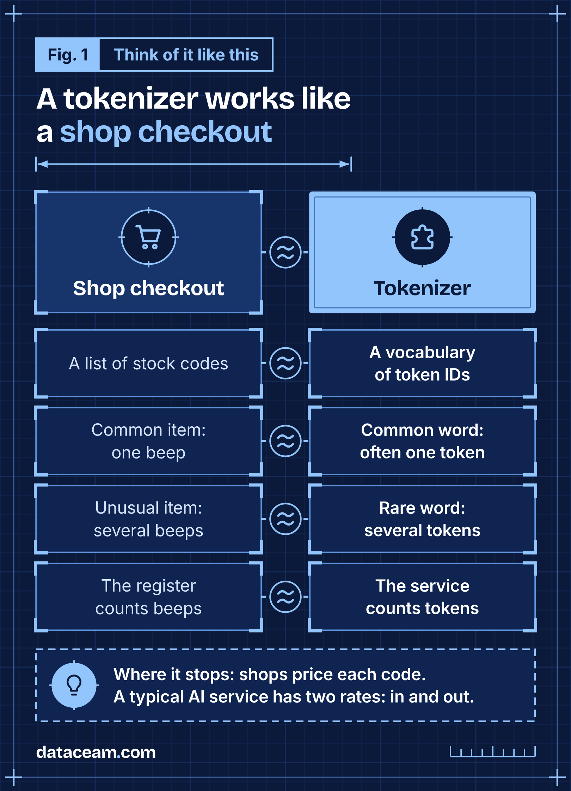
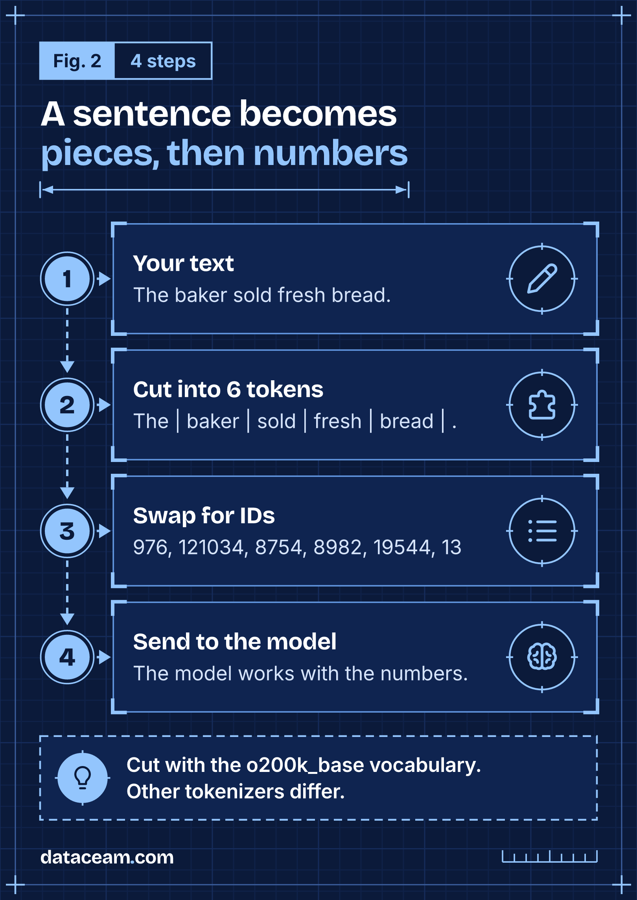
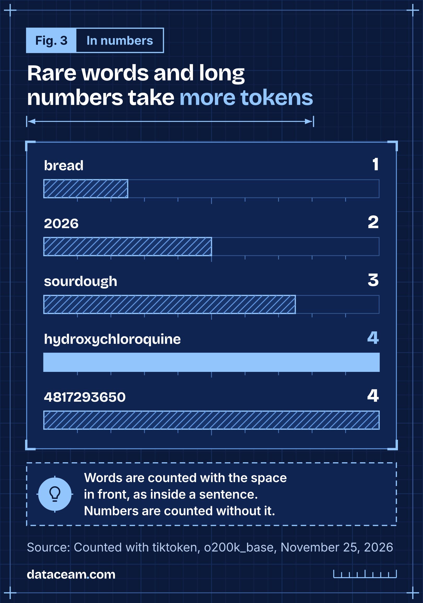

Tokens in AI are the small pieces of text that a language model reads and writes. A token can be a whole word, part of a word, a punctuation mark or a single character. In English, one token is roughly three quarters of a word. The model never works with your sentence as you typed it. It works with a list of tokens, each stored as a number.

You meet tokens in three places. They are usually the main unit on the bill when you pay for AI by use. They limit how much text a model can work with at once. And they help explain some odd mistakes, such as a chatbot that can write a poem and then miscount the letters in a word.

## What are tokens in AI models, and what do they look like?

A token is one item from a fixed list that the model uses for all text. The list is called the vocabulary, and each item has an ID number. Software called a tokenizer cuts your text into items from that list. OpenAI gives a simple pair of examples: [" the" is a single token, while " tokenization" becomes " token" and "ization"](https://developers.openai.com/api/docs/concepts). The space in front of a word usually belongs to the token.

Picture a shop checkout. Every product has a stock code. A loaf of bread is so common that it has its own code and takes one beep. A custom gift basket has no code, so the cashier scans the parts: the box, the jam, the ribbon. Anything the shop sells can be rung up, either as one item or as several.

*The customer sees a basket. The register sees only a list of codes, and a model sees only a list of token IDs.*

The checkout stops matching in two places. The parts of a gift basket are real products, but a piece of a word, such as "ough", often means nothing alone. And in a shop, each code has its own price. A typical AI service charges one rate for every token going in and another rate for every token coming out, whatever the token says.

### What is a tokenizer?

A tokenizer is the part that turns text into token IDs, and turns IDs back into text. It isn't the model itself. It works before and after the model, following rules that were fixed when the vocabulary was made. The model in the middle is the part that [predicts what comes next](/guides/what-is-an-llm/).

> **In short:** A token is a piece of text with an ID number. The tokenizer does the cutting, and the model works with the numbers.

## How many words is a token?

One token is about 0.75 of an English word, or about 4 characters, according to [OpenAI's rule of thumb](https://developers.openai.com/api/docs/concepts). Turned around, 1,000 words come to roughly 1,333 tokens (1,000 ÷ 0.75).

It is a rough guide, and OpenAI calls it [an estimate, not an exact count](https://help.openai.com/en/articles/4936856-understanding-and-counting-tokens). Other models differ. Anthropic says Claude 4.7 and later models use a newer tokenizer that makes [about 30 percent more tokens for the same text](https://platform.claude.com/docs/en/about-claude/glossary) than its earlier ones.

| Text | Rough token count | How it is worked out |
|---|---|---|
| A 75-word email | 100 | 75 ÷ 0.75 |
| A 300-word page | 400 | 300 ÷ 0.75 |
| A 1,000-word report | 1,333 | 1,000 ÷ 0.75 |
| A 60,000-word book | 80,000 | 60,000 ÷ 0.75 |

## A worked example: cutting a sentence into tokens

Two sentences with the same number of words can have very different token counts. Here are two five-word sentences, cut by one real tokenizer. The tool is OpenAI's free [tiktoken](https://github.com/openai/tiktoken) software with a vocabulary named o200k_base. Another tokenizer may cut them differently. A dot marks a space that belongs to the token.

1. Start with common words: "The baker sold fresh bread."
2. The cut is `The` `·baker` `·sold` `·fresh` `·bread` `.` That is 6 tokens for 5 words, because the period counts. Their IDs are 976, 121034, 8754, 8982, 19544 and 13.
3. Check the rule of thumb. The sentence has 27 characters, and 27 ÷ 4 is about 7. The estimate, 7, is close to the real count, 6.
4. Now use rarer words: "Unbelievably, the baker sold sourdough."
5. The cut is `Un` `bel` `ievably` `,` `·the` `·baker` `·sold` `·sour` `d` `ough` `.` That is 11 tokens, again for 5 words.
6. Check again. The sentence has 39 characters, and 39 ÷ 4 is about 10. Dividing the 5 words by 0.75 gives about 7, which is well short of 11.

*These ID numbers belong to one vocabulary, o200k_base. Another tokenizer would use different ones.*

The two sentences differ by 5 tokens. Rare words take more pieces, and punctuation adds its own. Position matters too. In this vocabulary, "strawberry" with no space in front of it is three tokens (`st` `raw` `berry`), but in the middle of a sentence, with the space attached, it is one. The drug name "hydroxychloroquine" takes four tokens with the space attached. Numbers without a space in front are cut too: 2026 takes two tokens (`202` `6`) and 4817293650 takes four.

*The ten-digit number takes as many tokens as the eighteen-letter drug name.*

## Why do AI models use tokens instead of whole words?

Models use tokens because a fixed list of pieces can build any text, while a fixed list of words can't. With whole words, the list would be huge and would still miss names, typos and new words. Hugging Face's course explains that a word missing from such a list becomes [an "unknown" token](https://huggingface.co/learn/llm-course/chapter2/4), and information is lost. Single characters would avoid that, but every text would turn into a very long list.

Pieces of words sit between the two. [Common words stay whole, and rare words are built from parts](https://huggingface.co/docs/transformers/main/en/tokenizer_summary). A widely used way to choose the pieces is byte pair encoding, or BPE. The idea is simple enough to do on paper.

Take four words: sing, ring, king, ink. Start with single letters.

- Count the neighbors. The pair i + n appears in all four words, more than any other pair, so join it into "in".
- Count again. Now in + g appears three times, in sing, ring and king, so join it into "ing".
- Keep going until the list is as long as you want.

You now have "ing" as a piece, without anyone teaching the program grammar. Many real vocabularies are built on the same idea from far more text. The o200k_base vocabulary in the example above has about 200,000 entries.

> **In short:** Word pieces keep the list short enough to handle and still let the model read a word it has never met.

## How are tokens counted and priced?

Developers who use an AI model through its programming interface, called an API, usually pay per token. Prices are quoted per million tokens, and input and output have separate rates. Input is what you send. Output is what the model writes. In a chat app with a monthly fee, you usually don't see this count.

Here is the arithmetic with one real price. On November 25, 2026, OpenAI listed its gpt-6.1-sol model at [$2.00 per million input tokens and $10.00 per million output tokens](https://developers.openai.com/api/docs/pricing). That is the rate for shorter requests on Standard, the normal service. Other rates exist, such as a lower one for repeated text. Prices change, so check the page before you plan a budget.

Say you send a 1,000-word report and get a 200-word summary.

| Part | Tokens | Cost |
|---|---|---|
| Report in | 1,333 | 1,333 × \$2 ÷ 1,000,000 = \$0.002666 |
| Summary out | 267 | 267 × \$10 ÷ 1,000,000 = \$0.002670 |
| Total | 1,600 | \$0.005336, about half a cent |

On these numbers, one summary costs about half a cent, and a thousand cost about \$5.34. A real bill can be higher. This leaves out your written instruction, and models that reason before answering [bill that hidden work as output](https://help.openai.com/en/articles/4936856-understanding-and-counting-tokens).

The summary has a fifth of the tokens of the report, yet costs about the same, because each output token costs five times as much here.

### How do tokens set the limits?

Every model has a limit on how many tokens it can handle at once, called its [context window](/guides/context-window/). OpenAI's documentation says [the prompt and the generated output together](https://developers.openai.com/api/docs/concepts) must stay within a model's maximum length. A long pasted document uses up space that the answer may need.

## Why can't AI count the letters in a word?

AI often can count letters, but it makes more mistakes than you'd expect, and tokens are probably one part of the reason. A model that gets "strawberry" as one ID, or as three pieces, isn't given the ten letters one by one. It has to rely on what it learned about the spelling.

Tokens aren't the whole story. A 2024 paper by Fu and colleagues lists [several suspected causes](https://arxiv.org/abs/2412.18626): tokenization, limits in attention (how a model weighs the different parts of its input), and too little [training](/guides/training/) on single characters. In their tests, models could recognize the letters but had trouble counting them. The authors concluded that tokenization was probably not the main problem. Errors were most strongly tied to letters that appear more than once in a word. How common the word was made little difference.

Numbers can be cut up too. In o200k_base, the number 4817293650 becomes four pieces (`481` `729` `365` `0`), which is an awkward way to do arithmetic. For exact counts and sums, use a calculator or a spreadsheet, or ask the chatbot to use a code tool if it has one.

### Do other languages use more tokens than English?

Often, yes, though it depends on the language and the tokenizer. In a 2023 study, translations of the same text had token counts that [differed by up to 15 times in some cases](https://arxiv.org/abs/2305.15425). Newer tokenizers may give other figures. More tokens can mean a higher bill and less text in the same window. If you work in several languages, test a sample of each.

> **In short:** The way text is cut is probably one reason models slip on letters. It also means long numbers and many languages take more tokens.

## Common mistakes about tokens

Most mistakes come from trusting one number too much, such as a rough estimate or a single price.

1. Treating the three-quarters rule as exact. It is an average for English. Code, tables and other languages can be far from it.
2. Looking only at the input price. The longer the answer, the more the output price matters, and hidden reasoning can count as output.
3. Comparing two models by price per token alone. OpenAI warns that models can [split the same text differently](https://help.openai.com/en/articles/4936856-understanding-and-counting-tokens), so the cheaper rate may not give the cheaper job.
4. Thinking that a token holds meaning by itself. It is only a piece with a number. Inside the model, it is turned into a longer list of numbers, called an embedding, that captures how it is used.

## How to count the tokens in your own text

You can count tokens for free in a couple of minutes.

1. Open [OpenAI's Tokenizer page](https://platform.openai.com/tokenizer), which the company's [help article](https://help.openai.com/en/articles/4936856-understanding-and-counting-tokens) recommends for plain text. For another company's model, use that company's counting tool.
2. Paste a paragraph from an email you've already sent. Leave out anything private.
3. Write down the number of tokens. Get the number of words from a word processor, or count them by hand.
4. Divide tokens by words. Around 1.3 matches the rule of thumb (1 ÷ 0.75 is about 1.33).
5. Try a list of product codes, a name and a sentence in another language, and see how the ratio changes.

Once you know your own ratio, you can estimate the cost and size of a job before you start. The next useful step is to see what happens when the tokens no longer fit, in [the guide to context windows](/guides/context-window/). The [LLM basics page](/guides/topic/llm-basics/) lists the other guides on this subject.
