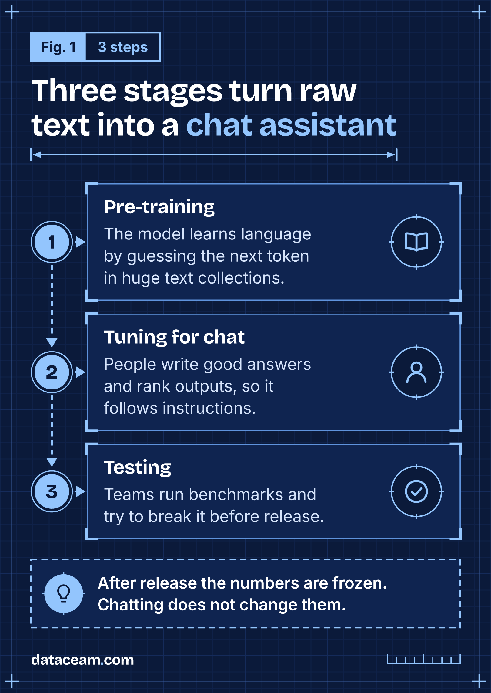
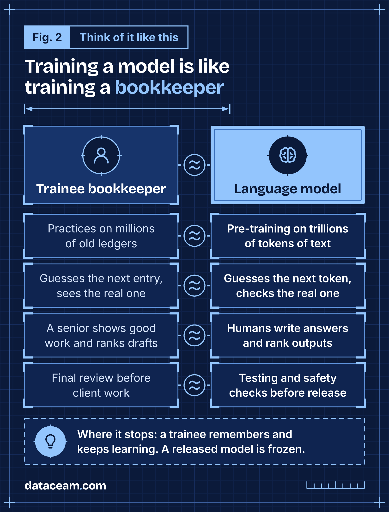
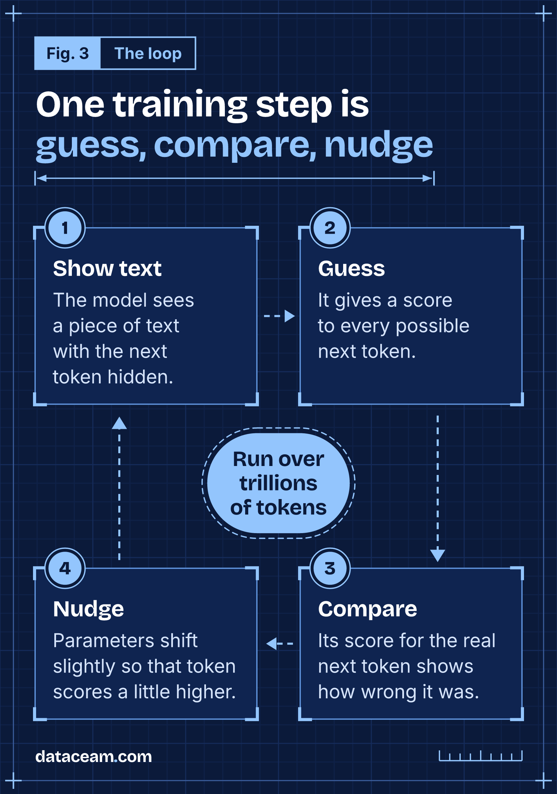

An AI model is trained in stages. First it practices on a huge pile of text by guessing the next small chunk, called a token, and gets its internal numbers nudged each time it misses. Then people show it good answers and rank its drafts so it learns to follow instructions. Last, teams test it and run safety checks before release.

You may have wondered how a chatbot "learned" anything, or whether it is still learning from your questions. The answers change how you treat its dates, its mistakes and the things you type into it. The short version of that last point: a released model is frozen, but the app around it may still keep your chats.

## How is an AI model trained, stage by stage?

Training happens in three stages: pre-training, tuning for chat, and testing. The models behind chatbots are large language models (LLMs), covered in [our overview of LLMs](/guides/what-is-an-llm/). This guide covers how one gets good at its job.

*The order matters: language first, good manners second, checks last.*

Here is a picture to hold on to. A trainee bookkeeper starts by working through millions of old ledgers. For each one they guess the next entry, then see the real one and adjust. Later a senior bookkeeper shows them what good work looks like and ranks their drafts from best to worst. Before the trainee touches a real client, someone reviews their work. That is the whole process in miniature.

*The comparison breaks in one place. A trainee keeps learning on the job. A released model does not.*

> **In short:** Training has three stages. The model learns language from text, then learns to follow instructions from people, then gets tested.

## Where does the training data come from?

Most training text comes from large collections of public material, such as web pages, books and code. Meta says it trained Llama 3 on about 15 trillion tokens, a collection of publicly available online text, which it filtered and cleaned (see [the Llama 3 paper](https://arxiv.org/abs/2407.21783) and the [Llama 3 8B card](https://huggingface.co/meta-llama/Meta-Llama-3-8B)). The filtering included removing duplicate pages and websites known to hold large amounts of personal information.

How big is 15 trillion? A token is about 0.75 of an English word, which is a rule of thumb covered in [our guide to tokens](/guides/tokens/). So 15 trillion × 0.75 is roughly 11 trillion words. If a novel has about 80,000 words, that is around 140 million novels' worth of text. This is only a rough comparison, because the real mix includes code, math and several languages.

Where training data comes from is also a live argument, and it is not settled. Authors, publishers and artists have questioned whether using their work to train models is allowed. The U.S. Copyright Office published a [report on generative AI training](https://www.copyright.gov/ai/) in May 2025, in a pre-publication version, and says a final version will follow. Courts and lawmakers in different countries are still working through the question. Many companies also don't publish a full list of what they used, so outsiders often can't check.

## What happens in one training step?

One training step has four parts: show the model some text, let it guess the next token, compare the guess with the real token, and nudge its parameters. Parameters are the numbers inside the model that training adjusts, explained in [our guide to parameters](/guides/parameters/). Everything the model learns comes from this loop, run over trillions of tokens.

*The loop has no teacher in it during pre-training. The text itself supplies the right answer.*

Here is one step with made-up numbers. The score the model gives each possible token is a probability, and the real text is "The cat sat on the mat".

1. Show the model "The cat sat on the" and hide the next word.
2. The model guesses. It gives "sofa" 40%, "floor" 25%, "mat" 10%, and spreads the rest across other tokens.
3. Compare with the real next word, "mat". The model gave it only 10%. IBM's explainer calls the measure of this error [a loss function](https://www.ibm.com/think/topics/model-training), and training tries to make it smaller. A common way to score this penalty is a formula that gives a big penalty when the right token got a low score and almost none when it got a high one: -ln(0.10) = 2.30.
4. Nudge every parameter a tiny amount in the direction that makes "mat" more likely. Next time the model gives "mat" 12%, and the penalty drops to -ln(0.12) = 2.12.

One nudge barely matters. But the same text and many other texts come around again and again, so the nudges add up. IBM notes that many neural network models adjust their parameters with a family of methods called gradient descent, which means taking small steps downhill on the error.

A real run doesn't work on one sentence at a time. It makes guesses on millions of tokens at once, then gives the parameters one combined nudge. Meta's Llama 3 paper describes about 1.2 million of these steps for its largest model. That batch work is why it needs so many chips (more on that below).

> **In short:** Show text, guess, compare with the truth, nudge the numbers. Pre-training is that loop run on a vast amount of text.

### What is overfitting?

Overfitting is when a model matches its training examples so closely that it does poorly on new ones. Google's machine learning course puts it as creating a model that [memorizes the training set](https://developers.google.com/machine-learning/crash-course/overfitting/overfitting) instead of learning patterns that carry over.

Think of a student who memorizes last year's exam answers. They score perfectly on that exam and fail a new one. A model that generalizes, in Google's wording, makes good predictions on new data.

The check is simple. Teams hold back some examples and never train on them. If the error on the training examples keeps falling while the error on the held-back ones stops falling or rises, the model is memorizing. Google describes this as the two loss curves diverging. IBM describes the same check as testing on examples the model has not seen.

## How do humans help train chatbots?

After pre-training, a model can continue text but doesn't reliably answer questions. People then teach it to follow instructions in two main ways: they write good example answers, and they rank the model's own answers from better to worse.

OpenAI's InstructGPT paper describes the method. Labelers wrote demonstrations of the behavior they wanted, and the team used them to fine-tune GPT-3 in the first step. Fine-tuning means training an already trained model a bit further on a smaller, chosen set of examples.

Labelers then ranked several model outputs. A second model learned to predict which answers people prefer, and a method called reinforcement learning from human feedback (RLHF), which rewards the model for answers the second model scores highly, used it to tune the first model further. [The paper](https://arxiv.org/abs/2203.02155) reports that people preferred outputs from the 1.3 billion parameter InstructGPT to those of the 175 billion parameter GPT-3, which is more than 100 times larger.

The authors also say the models still make simple mistakes. Anthropic's team describes a similar approach for a helpful and harmless assistant in [its RLHF paper](https://arxiv.org/abs/2204.05862), with fresh human feedback fed back in about weekly. Meta's [Llama 2 card](https://huggingface.co/meta-llama/Llama-2-7b) says its tuning used over one million new human-annotated examples, and the Llama 3 paper describes six rounds that each combined supervised fine-tuning with a method called Direct Preference Optimization, which learns from ranked pairs directly.

Teams test the result before release. For Llama 3, Meta's paper describes red teaming, where experts try to make the model produce harmful output so the problems can be fixed. It also says no testing can be sure to find every risk.

| Stage | What it uses | What it teaches |
|---|---|---|
| Pre-training | Trillions of tokens of text | Language, facts and patterns |
| Tuning for chat | Human-written answers and rankings | Following instructions, tone, safer replies |
| Testing | Benchmarks and expert attacks | Where it fails, so problems can be fixed before release |

You can also shape an already trained model yourself, with fine-tuning or with careful prompting. [Reasoning models](/guides/reasoning-models/) add one more round of reinforcement learning so they work through problems step by step.

## How long does AI training take and what does it cost?

For large models, training takes weeks of computing on thousands of chips. The chips are graphics processing units (GPUs), processors built to do huge numbers of simple calculations at once, and the training needs far more than one machine can hold. Meta's paper says its largest Llama 3 model was trained on up to 16,000 H100 GPUs, a data-center chip from NVIDIA with 80 GB of memory each.

Companies report effort in GPU hours, meaning one chip working for one hour. The [Llama 3 8B card](https://huggingface.co/meta-llama/Meta-Llama-3-8B) lists 1.3 million GPU hours. Here is what that means in time, as a sum only (the card doesn't say how many chips were used):

1. On 16,000 chips at once: 1,300,000 ÷ 16,000 = 81 hours, about 3.4 days.
2. On 1,000 chips: 1,300,000 ÷ 1,000 = 1,300 hours, about 54 days.

For comparison, the [Llama 2 7B card](https://huggingface.co/meta-llama/Llama-2-7b) lists 184,320 GPU hours for the 7B model, about 7.7 days on 1,000 chips. It describes the whole Llama 2 family as using about 3.3 million GPU hours. These are figures for pre-training one model. They don't include research runs that failed, tuning, or testing.

Cost depends on the price of a GPU hour, which these sources don't give, so there is no reported dollar figure to quote. As an illustration only: at a made-up price of $2 per GPU hour, 1.3 million hours would come to $2.6 million. Real prices vary by company and contract, and companies rarely publish what they paid.

With 16,000 chips, something breaks often. The Llama 3 paper counts 466 job interruptions during a 54-day stretch of pre-training, so a big part of the work is keeping the run going. Why graphics chips suit this work is a topic of its own.

## Does the model keep learning from your chats?

No. A finished model is frozen: its parameters don't change while you talk to it. Meta describes Llama 3 8B as ["a static model trained on an offline dataset"](https://huggingface.co/meta-llama/Meta-Llama-3-8B). Within one conversation, the model can use what you wrote earlier, but only because it is still in view in the context window, covered in [our context window guide](/guides/context-window/). Start a new chat and it's gone.

What an app does with your chats is a separate matter. As of November 2026, [OpenAI's help page on data use](https://help.openai.com/en/articles/5722486-how-your-data-is-used-to-improve-model-performance) says the company may use content from consumer ChatGPT to train its models, and you can turn this off in Settings under Data controls. It says business, enterprise, education and API content is not used for training by default. Other apps have their own rules, so read the privacy settings of the one you use.

This also explains the knowledge cutoff, the date after which the model has no training text. Meta lists March 2023 for Llama 3 8B, though the model was released on April 18, 2024. Part of the gap is time: collecting data, training, tuning and testing all take months. Some apps add a web search so the model can read fresh pages, but the model itself is unchanged.

> **In short:** Training happens before release. Chatting uses the model but doesn't change it. Your chats may be saved by the app, and that is a separate choice you can often change.

## Common mistakes about AI training

1. "The AI learns from every chat I have." Not quite. The model is frozen while you chat. The app may save chats for a future version, so check your settings.
2. "It looks things up in a database of what it read." No, not in the usual sense. Training turns text into adjusted numbers. Nothing like a library of pages is stored, although a model can sometimes repeat passages it saw often.
3. "Training is one step." It is several stages with different goals. People shape the behavior too, not just the machines.
4. "More data always means a better model." Not always. Data quality, filtering and tuning count too, and a model can overfit to what it saw.
5. "The model knows what happened yesterday." Not unless the app adds search. It only knows text up to its cutoff.

## Check a model's training details yourself

Pick any open model, such as Llama 3, and open its model card on Hugging Face. Look for the number of tokens it was trained on, the GPU hours, and the knowledge cutoff. Then do the sums from this guide: divide the GPU hours by the number of chips to get days, and multiply the tokens by 0.75 to get a rough word count.

Next, ask a chatbot what its knowledge cutoff is, then ask about something that happened soon after. If it gets it wrong or says it doesn't know, you have seen the cutoff for yourself.

To keep going, read [what an LLM is](/guides/what-is-an-llm/), what [parameters](/guides/parameters/) are, how [tokens](/guides/tokens/) work, or browse the [LLM basics page](/guides/topic/llm-basics/).
