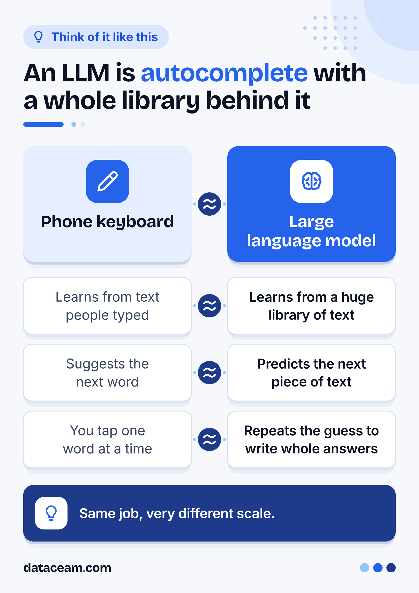
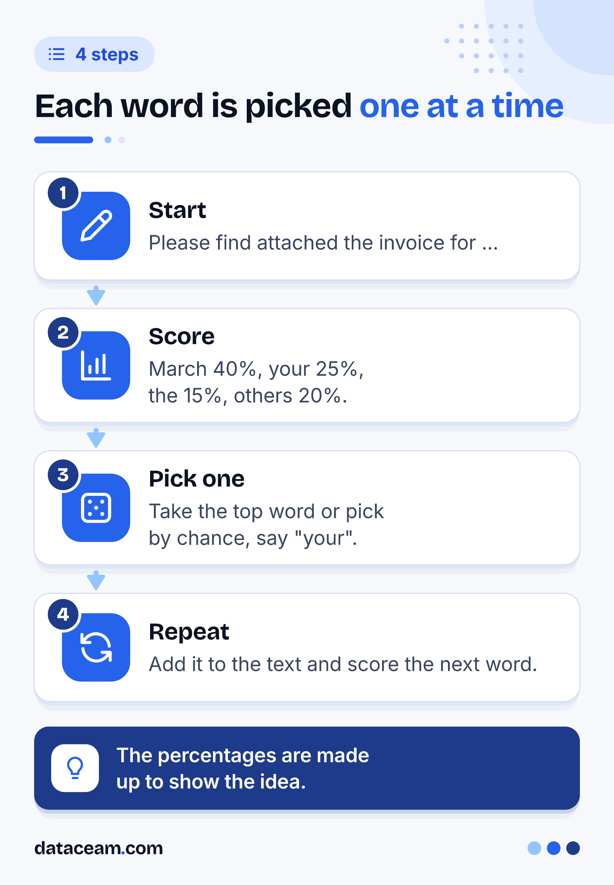
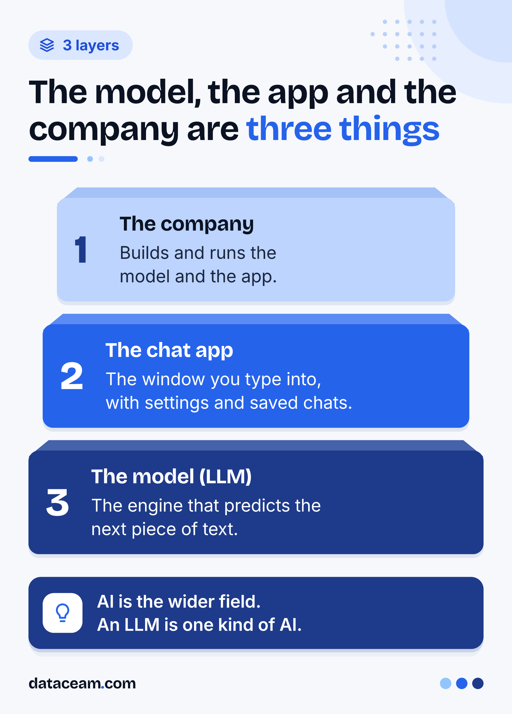

A large language model, or LLM, is a computer program trained on a very large amount of text to predict what comes next in a piece of writing. Given the start of a sentence, it picks a likely next word, adds it, and repeats until a full answer exists. Chatbots like ChatGPT are built on this one trick, scaled up enormously.

You probably already meet this in daily life. You paste a long email into a chatbot and ask for a shorter version. You get a confident answer about a tax rule and wonder whether to trust it. Knowing what is happening inside makes you a better user: you will know what to ask for and what to double-check.

## How does a large language model work?

An LLM works like the suggestion bar above your phone keyboard, only far bigger. You type "See you" and the phone offers "soon", "later", "tomorrow". It learned those suggestions from text. Google researchers described exactly this setup in [a paper on predicting the next word on a smartphone keyboard](https://arxiv.org/abs/1811.03604).

Now picture a clerk who has read an entire library and has a remarkable memory for how sentences usually continue. Hand that clerk half a sentence and they can finish it, then keep going. That is close to what an LLM does. Google's own course describes a language model as something that [estimates how likely each possible next piece of text is](https://developers.google.com/machine-learning/resources/intro-llms).

*The keyboard and the model do the same job. The difference is how much they have read and how much text they can look at before guessing.*

The "large" refers to two things. The model is trained on far more text than a keyboard ever sees, and it contains far more adjustable numbers, called parameters. The GPT-3 paper, for example, [describes a model with 175 billion parameters](https://arxiv.org/abs/2005.14165). More text and more parameters let the model pick up much subtler patterns than a keyboard can.

The analogy has a limit. A clerk reads for meaning and remembers where they read it. An LLM doesn't keep a shelf of books to look things up in. It keeps only the patterns it picked up, and it can't point to a page.

> **In short:** An LLM is autocomplete at a much larger scale. It predicts the next piece of text, adds it, and repeats.

## A worked example: finishing an invoice email

Here is one email sentence, completed step by step. The percentages are made up to show the idea. A real model works with [tokens](/guides/tokens/), which are small chunks of text, often a whole word or part of one. We use whole words here to keep it readable.

The start of the sentence: "Please find attached the invoice for ..."

1. The model looks at every word so far and gives each possible next word a score. Say "March" gets 40%, "your" gets 25%, "the" gets 15%, and thousands of other words share the remaining 20%. Check: 40 + 25 + 15 + 20 = 100.
2. It picks one. It may take the top choice, or pick at random in proportion to the scores, which is one reason two answers to the same question can differ. Google's course describes both options, [taking the highest-probability word or choosing at random among the likely ones](https://developers.google.com/machine-learning/resources/intro-llms).
3. Say it picks "your". The sentence is now "Please find attached the invoice for your ...".
4. The model scores every word again, this time with "your" included. "Recent" may lead, then "order", then "services".
5. It picks again, and the loop repeats until the model produces a signal that means "stop".

*Because each pick can be random, the same start can end in a different sentence each time.*

Notice what never happens: the model never opens a file to see whether an invoice exists. It only asks which words fit here. That is also why the same engine can write a poem and a refund email.

## Where does an LLM get its knowledge from?

An LLM gets what it knows from its training text: books, articles, websites, code and similar material. IBM says the first big round of training, called pretraining, uses [billions or trillions of words](https://www.ibm.com/think/topics/large-language-models). Training means showing the model a piece of text with the next word hidden, letting it guess, and nudging its parameters whenever it guesses badly. AWS describes it the same way: the model [adjusts its parameters to predict the next token](https://aws.amazon.com/what-is/large-language-model/).

After a huge number of these guesses, the model has absorbed spelling, grammar, common facts, writing styles and many ways of reasoning that show up in text. What it has not built is a database. It can't look up "the population of a small town in Ohio" in a table. It reconstructs an answer from patterns, and that works well for things said many times and badly for things said rarely.

The design that made this practical is the transformer, introduced in [a 2017 paper called "Attention Is All You Need"](https://arxiv.org/abs/1706.03762). Its key idea is letting the model weigh all the earlier words at once instead of reading strictly in order. You don't need the details to use an LLM.

### From text finisher to helpful assistant

A model trained only on next-word prediction would, if you typed a question, often just keep writing more questions. Chat models get a second round of [training](/guides/training/). People write examples of good answers, and then people rank several answers from best to worst. The model is adjusted toward the ranked-higher style. [The InstructGPT paper](https://arxiv.org/abs/2203.02155) describes this. In its tests, people preferred answers from a 1.3-billion-parameter model trained this way over the 175-billion-parameter GPT-3, which has more than 100 times as many parameters.

### A small glossary

| Term | Plain meaning |
|---|---|
| Token | A small chunk of text the model reads and writes |
| Parameter | One of the adjustable numbers inside the model |
| Training | Learning from text by guessing the next piece and correcting mistakes |

> **In short:** An LLM learns patterns from huge amounts of text, then gets extra training on human examples and rankings so it follows instructions.

## What is the difference between an LLM, ChatGPT and AI?

AI is the broad field, an LLM is one kind of AI that works with text, and ChatGPT is a chat app that uses LLMs. Many articles blur these three, so it helps to separate them.

*When someone says "the AI said," they usually mean the whole stack, but each layer can change on its own.*

| Name | What it is | Example |
|---|---|---|
| AI | The wide field of software that does tasks that normally need human judgment | Face recognition, translation, chess programs, LLMs |
| LLM | A model trained to work with text by predicting what comes next | The engine behind a chatbot |
| Chat app | A product that wraps a model with a chat window, memory of the conversation and settings | ChatGPT, Gemini, Claude |
| Company | The organization that builds and runs the model and the app | OpenAI, Google, Anthropic |

These names are examples, not recommendations. The practical point is that the same model can sit behind different apps, and an app can switch to a newer model over time. If an answer is poor, the cause might be the model, the app's settings or your question.

## Does an LLM understand what it says?

Not in the way a person does: it produces likely text and has no step that checks whether it is true. The model has learned deep patterns in how people explain, argue and describe, and that can look like understanding.

A useful rule for a beginner: treat an LLM as a very well-read writer with no way to verify anything. It can often explain a concept well. It can't promise that a specific date or quote is correct.

### Why do LLMs make mistakes or invent facts?

LLMs invent facts because they are built to produce fluent text, and a fluent sentence is not the same as a true one. In the field this is called a hallucination: a confident, plausible statement that is false. IBM lists it among the [main limits of LLMs](https://www.ibm.com/think/topics/large-language-models).

OpenAI's research team gives two reasons in [its explanation of why language models hallucinate](https://openai.com/index/why-language-models-hallucinate/). First, patterns like spelling become reliable with scale, but arbitrary facts that appear rarely, such as one person's birthday, have no pattern to learn. Second, many tests (called benchmarks) reward a guess over an honest "I don't know", so models learn to guess.

Training also stops at some date, so the model may not know recent events. A vague question also leaves more room to guess wrong.

### A habit for checking answers

Before you use any name, number, date, quote or legal or medical claim from an LLM, find it in a source you can open yourself. Take 30 seconds. If you can't find it, treat it as unconfirmed. Asking the chatbot "are you sure?" doesn't count, because it will just produce another fluent reply.

> **In short:** Fluent does not mean true. Check specific facts against a real source before you rely on them.

## What are LLMs used for in everyday life?

People use LLMs to draft, rewrite, summarize, translate, explain and write code. AWS lists [copywriting, answering questions, sorting text by meaning and generating code](https://aws.amazon.com/what-is/large-language-model/) among typical uses. The pattern is consistent: they are strong where the task is about language and a person reviews the result.

| Good fit | Poor fit |
|---|---|
| Shortening a long email | Looking up one exact figure, such as a tax rate |
| Explaining a tricky paragraph in plain words | Recent news or prices |
| Drafting a first version of a letter | Long exact arithmetic |
| Translating a short note | Legal or medical decisions with no expert check |
| Brainstorming names or ideas | Anything where one wrong detail does real harm |

Try it yourself in two minutes. Paste a paragraph you know well into a chatbot and ask for a summary. Then compare the summary with the original and note anything added or changed. That small test shows both the strength and the weakness better than any article can.

## Common myths about LLMs

- **"It searches the internet for each answer."** The model itself doesn't. Many chat apps now add a web search step and decide on their own when to use it, but that is a separate tool bolted on top.
- **"It stores a copy of everything it read."** No. It keeps adjusted numbers, not the original pages, and it can't reliably quote a source.
- **"If it sounds confident, it is right."** Confidence is part of the writing style it learned. It tells you little about accuracy.
- **"Bigger always means better."** Not always. The InstructGPT result above shows a much smaller model that people preferred after better training.
- **"AI and LLM mean the same thing."** An LLM is one kind of AI. Plenty of AI has nothing to do with text.

## Where to go next

The [LLM basics topic page](/guides/topic/llm-basics/) collects the guides in this group, and [the guides overview](/guides/) lists every guide.

If you want a hands-on step today, run the summary test from the previous section with a text you wrote yourself. Then try asking the same question twice and compare the answers. Seeing the differences first-hand is the quickest way to learn what an LLM can and can't do for you.
