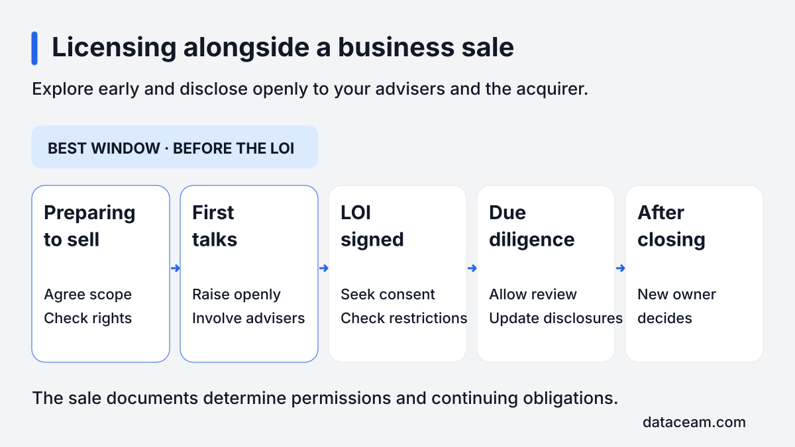
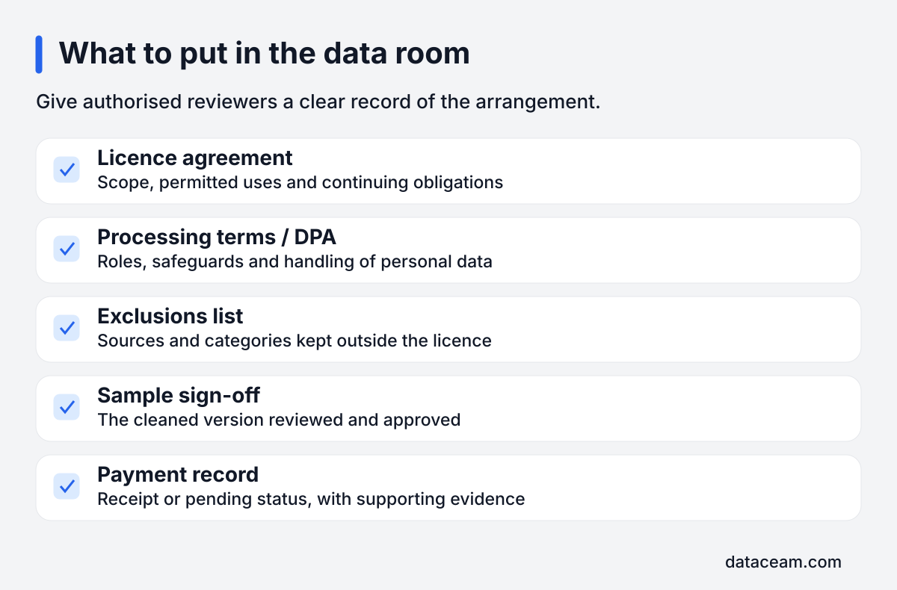

You can explore a non-exclusive licence over a de-identified copy of company records before selling the business. The clearest window is before the letter of intent, with open disclosure to your advisers and the acquirer. Check ownership, privacy, sale restrictions and who keeps the fee before making a commitment.

## What are you licensing before a business sale?

I work with several vetted AI data buyers. As an independent scout, I help owners assess whether their existing work records could fit a buyer's needs. This is separate from selling the company: the proposed licence covers a cleaned copy of approved records for agreed uses.

The company keeps its original records and continues operating. A non-exclusive licence is intended to let the sale go ahead as normal, subject to the sale documents and any required consent. It should not transfer control of the company's systems or prevent staff from using their own information.

Non-exclusive does not mean unrestricted. The agreement still needs to explain permitted recipients, uses, confidentiality, duration and any continuing duties. Your lawyer should examine those terms in the context of the planned sale, rather than relying on the label alone.

This is general information, not legal or tax advice.

The [home page](/) describes how an introduction works. Before discussing an export, I would ask what the business owns, which tools contain the records and how far the sale has progressed. That keeps the initial conversation proportionate to the decision you are actually making.

## Does it lower the sale price?

Acquirers usually consider normalised or recurring earnings when valuing an operating business. A one-off licence fee is ordinarily treated as non-recurring, so it usually does not change the earnings multiple by itself. It should not be presented as evidence that ordinary trading performance has improved.

That is a valuation starting point, not a promise about a particular transaction. An acquirer can still care about contractual restrictions, confidentiality, continuing liabilities and the strategic importance of the records. A licence that creates unresolved questions can affect negotiations even where the income is excluded from normalised earnings.

### When the data is the product

The important exception is a business whose product is the data itself. Licensing a core dataset may affect scarcity, exclusivity or the commercial rights the acquirer expects to obtain. The same concern can arise where access to unique information is central to the business model.

Ask your M&A adviser to distinguish incidental operational history from a core commercial asset. A support archive and a proprietary information product may need very different treatment. Do not assume that a non-exclusive licence has no effect simply because the originals remain in place.

Have your accountant explain how the income will be recognised and shown in the sale materials. Keep the one-off receipt distinguishable from recurring revenue, and make the underlying agreement available for review. Clear treatment is more useful than trying to make the fee improve a headline earnings figure.

## When should you do it?

My practical recommendation is to explore the idea before the LOI and disclose it openly. That gives the owner and advisers space to decide whether it belongs in the transaction at all. It also allows the proposed rights and proceeds to be discussed before expectations become fixed.

_Explore the licence during preparation or first talks, and make it visible before the LOI._

| Sale stage        | Practical position                              | Next action                                                          |
| ----------------- | ----------------------------------------------- | -------------------------------------------------------------------- |
| Preparing to sell | Usually the best window to assess fit and scope | Tell your advisers and check rights before commissioning exports.    |
| First talks       | There may still be time to agree an approach    | Raise the proposal openly with the acquirer through your adviser.    |
| LOI signed        | Proceeding needs the buyer's consent            | Check restrictions and obtain documented approval before commitment. |
| Due diligence     | Introducing a new licence is harder             | Add the documents to the review and allow time for questions.        |
| After closing     | It is the new owner's decision                  | Do not assume the former owner can authorise a licence.              |

An LOI can contain binding provisions even when the proposed purchase remains subject to contract. Exclusivity, confidentiality and conduct restrictions deserve particular attention. Your adviser should read the actual documents, including any separate undertakings, to identify the approval route.

During due diligence, the acquirer's team is already checking the business against a defined set of expectations. A new agreement can add questions and require updated disclosures. If there is not enough time for a proper review, discuss postponement rather than treating preparation as permission to sign.

## What belongs in the data room?

Give the acquirer a clear record of what was agreed and what happened. Use the data room's permissions to share the relevant documents with authorised reviewers. The goal is to explain the rights and obligations without placing a raw archive of customer or employee information in a broadly accessible folder.

Include the licence agreement, the data-processing agreement or DPA where applicable, the exclusions list, sample sign-off and the payment record. If a step has not happened, mark it as pending. Do not let a proposed scope look like an approved delivery.

_Keep the agreement, privacy documents, scope approval and payment evidence together for review._

### Make the documents tell the same story

The exclusions list should identify the sources and categories kept out. The sample sign-off should identify the reviewed version. The licence should describe the final permitted dataset and uses. If the scope changed during preparation, keep the final position clear and explain any outstanding action.

Add a short factual note covering who approved the arrangement, whether delivery is complete and what obligations continue. Include relevant consent correspondence. Avoid promotional language: the acquirer's advisers need to understand the transaction, not assess a sales pitch for the records.

Ask your lawyer whether particular documents need restricted access or redaction in the sale process. The data room itself is another disclosure environment, so its contents should receive the same care as any other transfer of confidential information.

## Which warranties and deal structures need attention?

Discuss disclosure against intellectual property, material contracts and data-protection warranties. A licence may be relevant to each category for different reasons: it grants rights, creates contractual obligations and may involve processing personal data. Your lawyer should determine what is required by the actual warranty wording.

Uploading an agreement is not always enough to make an effective disclosure. The purchase agreement may set a particular standard or require a specific disclosure letter. Identify the relevant clauses and explain the facts accurately, including any work that remains incomplete.

### Share sale

In a share sale, the agreement stays with the company because the legal entity remains the same. That does not eliminate the need to inspect change-of-control provisions or other consent requirements. Check whether the licence creates any duties that will continue under the new ownership.

### Asset sale

In an asset sale, the agreement may need consent to transfer. The transaction documents should identify whether the licence, the underlying records and associated obligations are included. Assignment, novation and retained liabilities need legal review rather than an assumption that everything follows the files.

For either structure, ask who will handle later queries, enforce restrictions and manage scheduled deletion of working copies. An operational handover should include these responsibilities, especially if the people who approved the licence are leaving the business.

## Who keeps the fee, and how is privacy handled?

Say who keeps the fee in the purchase agreement. The timing of receipt, treatment of cash and any completion adjustments can change the economic result. Your accountant and lawyer should agree how unpaid amounts, later payments and related costs fit the transaction.

Do not assume that receiving the fee before closing automatically settles the matter. Equally, an agreed licence that has not yet paid should not disappear from the sale discussion. Record the arrangement clearly so both sides understand which rights and obligations they are buying.

Customer and employee records need a GDPR assessment before extraction or cleaning. The company needs a lawful basis for processing personal data and must consider purpose, transparency, security and people's rights. A later de-identified copy does not remove those earlier duties.

Names and contact details are only part of the review. Free text, unusual events and attachments can identify people through context. Ask how the processing team tests for that risk, handles exclusions and documents deletion of raw working copies. Use the [preparation checklist](/insights/prepare-company-data-for-ai-licensing/) to plan the practical work without bypassing legal review.

## What should you ask your M&A adviser and lawyer?

Bring a written outline to your advisers while the proposal is still easy to change. It should describe the intended copy, the permitted use, the sources and the stage reached. A conversation based on a concrete scope is more useful than asking whether data licensing is acceptable in principle.

- Does the company own the relevant rights, including work created for clients?
- Is any proposed record central to the product being sold?
- Do the LOI or other undertakings require the acquirer's consent?
- How should the licence be disclosed against the purchase warranties?
- Does the agreement stay in place or require transfer consent?
- Who keeps the proceeds, and how are they treated at completion?
- Are the privacy assessment, processing terms and exclusions sufficient?
- Who manages continuing obligations after the ownership changes?

The [guide to eligible business data](/insights/what-business-data-ai-companies-buy/) can help describe the records, while the [FAQ](/faq/) explains the introduction process. Neither replaces your advisers' assessment of the actual sale documents.

## Want to know if your records qualify?

[Email me](/#contact) with a short description of the business, its tools and the current sale stage. Mention whether an LOI has been signed. Keep confidential transaction documents and personal records out of the initial message.

I'm paid a referral fee by the buyer. It costs you nothing.
