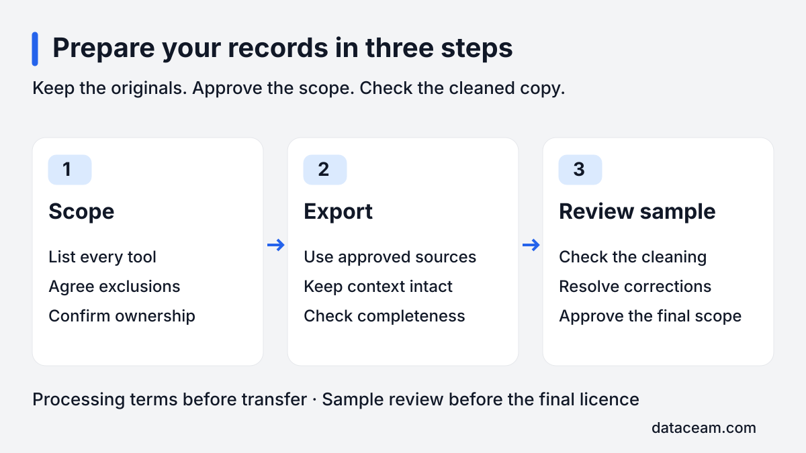
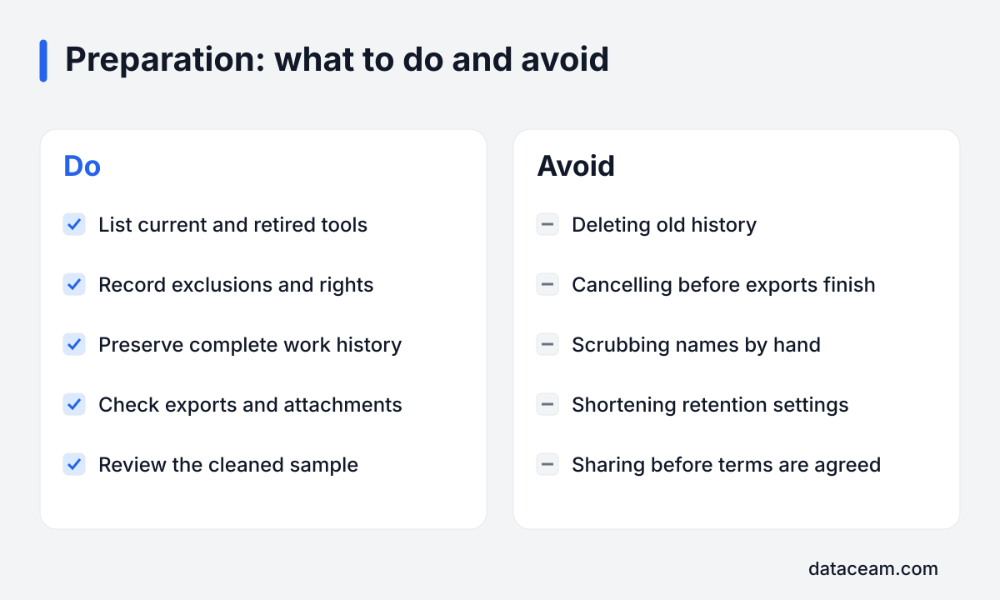

To prepare company data for AI training, agree which records you can license, export each approved tool, then review a cleaned sample before committing to the licence. Keep the originals intact. The aim is a usable, properly scoped copy of work history, with personal details and restricted material handled through an agreed process.

## What does preparing actually involve?

I take part in the referral programmes of a small number of AI-data buyers. As an independent referrer, I help establish whether your records might fit before anyone starts moving files. A useful first email describes the tools, the period covered and who owns the work. It does not need attachments containing customer or employee information.

Preparation has three jobs: agree the scope, export each tool, and hand over the approved material for cleaning and review. Each job needs an owner. In a small company that might be the founder and an IT administrator; elsewhere it may involve operations, security and the person responsible for privacy.

_Keep a clear approval point between deciding the scope, exporting records and reviewing the sample._

The [home page](/) explains the overall introduction process. This checklist focuses on the practical work inside your company. You are preparing evidence of real work, so preserve the connections between a request, the discussion around it and its eventual outcome.

## Step 1 — what belongs in the scope?

List every tool the company has used, past and present. Include retired systems, old archives, shared drives and exports saved during earlier migrations. Ask long-serving staff where work happened before the current setup. A closed project space may hold a complete history that the current dashboard cannot show.

For each source, note the account owner, approximate dates, teams involved, export route and rights position. Record whether the archive includes attachments and conversation history. Mark uncertainty explicitly rather than assuming that access means ownership.

### Mark the exclusions early

Keep client-owned systems outside the proposed scope unless the relevant rights have been established. Working inside a client's account does not make its contents yours to license. Apply the same caution to copies stored in your own workspace.

Mark HR, payroll and medical material as excluded. Flag NDA-restricted documents and national ID numbers. These may appear inside otherwise ordinary folders or messages, so exclusions need to describe content as well as locations.

- Name the source and the person who can approve its use.
- Identify mixed folders containing company and client material.
- Record restrictions imposed by contracts or confidentiality terms.
- Set aside uncertain records for review before exporting them.

Ask whoever understands the work to check the inventory. IT may know how to retrieve a folder without knowing that its contents belong to a client. A department owner may recognise those restrictions but need help locating the archive. Both views matter.

## Step 2 — how do you export each tool?

Ask your administrator to check the current plan and permissions before scheduling exports. Capabilities vary, and a successful download can still omit useful history. Use the approved scope as a checklist, then record what each export actually contains.

| Tool or source      | Who usually runs the export                                       | What to check                                                                                                                   |
| ------------------- | ----------------------------------------------------------------- | ------------------------------------------------------------------------------------------------------------------------------- |
| Slack               | Workspace owner or authorised administrator                       | Free and lower plans may export public channels only; check your plan and permitted scope.                                      |
| Microsoft 365       | Authorised administrator with the relevant eDiscovery permissions | An eDiscovery or admin export usually needs a defined search scope; check mail, files and attachments separately.               |
| Google Workspace    | Super administrator                                               | Admin data export can take days; check account eligibility, included services and where the archive is stored.                  |
| Jira and Confluence | Site administrator                                                | Site export options vary; check projects, spaces, attachments and whether the chosen route preserves history.                   |
| GitHub              | Organisation administrator or authorised repository maintainer    | Export approved organisation repositories with issues and pull requests; a code clone alone does not capture those discussions. |
| Notion              | Workspace owner or member with export permission                  | Check workspace export permissions, subpages, files and databases; some views or linked content may need separate attention.    |
| CRMs and help desks | System administrator or authorised operations lead                | Check relationships, notes, activity history and attachments alongside the main records.                                        |

### Preserve the relationships

A spreadsheet of customers is different from the history of how their requests were handled. In Salesforce or HubSpot, check whether exported activities remain connected to the relevant account and deal. In Zendesk, check that replies and resolution details remain attached to the original ticket. Availability usually depends on permissions, plan and export method.

Keep the export manifest and any warnings. Note the date range selected, filters used and missing objects. If an export says it completed with errors, record those errors before someone discards the notification. The receiving team needs to distinguish an actual gap in business activity from an incomplete download.

Do not change permissions simply to make everything exportable. A restricted channel or folder may be restricted for a good reason. Ask the responsible owner to resolve the scope instead. The [guide to what buyers look for](/insights/what-business-data-ai-companies-buy/) explains why connected history matters more than an indiscriminate pile of files.

## Step 3 — how do you hand over and review?

Once the scope and processing arrangements are agreed, upload through the agreed secure route or hand the exports to IT for transfer. Avoid circulating archives through ordinary email. Confirm who can access them, where they will be stored and when working copies will be deleted.

Before any transfer, put the necessary confidentiality and data-processing terms in place. Reviewing a sample before signing the final commercial licence does not mean sharing raw personal data without prior protection. Your privacy lead should be involved before processing starts.

Keep a manifest of the files handed over and the approved exclusions. Ask for a cleaned sample that contains complete examples across the proposed sources, rather than only the easiest records. It should show how a thread, its attachments and its outcome survive the cleaning process.

### Review meaning as well as redaction

Check whether you can still follow the work. If the same person becomes a different placeholder in every message, the conversation may become confusing. If an attachment disappears, a decision may no longer make sense. Record corrections and ask to review the revised sample.

Confirm that excluded material is absent and that confidential details have been handled as agreed. Only then decide whether the proposed licence and final scope are acceptable. Keep written sample sign-off with the version reviewed, so approval does not accidentally cover a later, different dataset.

## What should you avoid while preparing?

Do not delete old history to make the workspace look tidy. Older records may explain how a project developed or why a decision changed. Preserve the approved export without altering the source system just for presentation.

Do not downgrade plans or cancel subscriptions before exports finish and are checked. An archive may still need another attempt, and access to attachments may depend on the live account. Ask IT to confirm that downloads are complete and usable before changing account arrangements.

Do not scrub names by hand. Manual edits are easy to apply inconsistently and can break the structure that makes a conversation useful. Instead, identify the sensitive fields and agree how the cleaning process will treat them.

Do not shorten retention settings as a preparation step. That can remove records before the scope is settled. Equally, do not extend retention indefinitely just for a possible licence: existing retention duties and deletion requirements still need to be respected.

_Preparation should preserve useful context while keeping exclusions and access under control._

## How are client and employee details protected?

The cleaning requirements should be explicit: names, emails, phone numbers, addresses and account numbers are replaced with consistent placeholders within a thread. Secrets and API keys are removed. No re-identification key is kept. Ask the processing team to demonstrate these controls in the sample and confirm them in writing.

Those requirements are safeguards, not proof that every record is anonymous. An unusual job title, a distinctive incident or a combination of contextual details may still identify someone. Review free text and attachments as well as obvious fields, and exclude examples that cannot be handled adequately.

A GDPR lawful basis is needed for processing personal data, including the preparation and cleaning stages. Removing direct identifiers later does not settle whether the original processing was lawful. The responsible privacy adviser should assess purpose, transparency, rights, security and any international transfers before work begins.

Check that customer contracts and employee information are consistent with the proposed use. Ownership of a business system does not remove confidentiality obligations or data-protection duties. The [FAQ](/faq/) covers the main process questions; your own circumstances need a specific assessment.

## What is a realistic preparation timeline?

Allow a few weeks as a working assumption, with room for delays. The inventory and rights review come first, followed by export scheduling, secure transfer, cleaning and sample corrections. These activities can overlap where appropriate, but unresolved ownership should not be bypassed to save time.

The slowest source often sets the pace. A super administrator may be unavailable, an archive may need recovery, or a download may lack attachments. Keep a simple status list showing the owner, blocker and next action for every source.

If a business sale is approaching, start the scope discussion alongside your sale preparations. The [guide to licensing before selling a business](/insights/license-company-data-before-selling-business/) explains why the transaction stage affects decisions and disclosure. Give your advisers the proposed scope before a new commitment complicates their review.

## Want to know if your records qualify?

[Email me](/#contact) with your tools, the history available and any known ownership restrictions. Keep the first message descriptive; there is no need to send records. I can help identify the next sensible question before your team starts exporting.

I'm paid a referral fee by the buyer. It costs you nothing.
