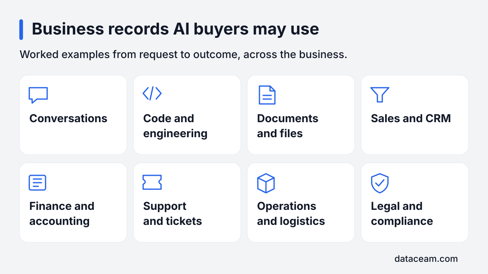
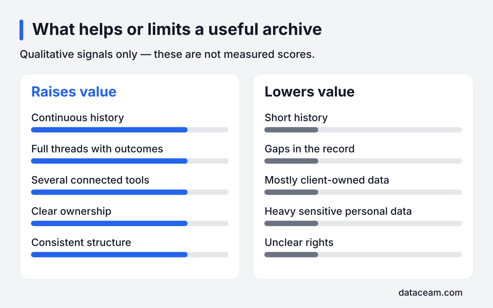

AI companies buy licensed copies of business records that show how real work happens: conversations, engineering history, documents, sales activity, finance workflows, support, operations and compliance. Useful records connect a request to decisions and an outcome. Whether yours qualify depends on their context, continuity, ownership, privacy risks and the buyer's needs.

## Why do AI developers want private work records?

Public web text has largely been used already in training, and more of the same does not necessarily show how a business completes a task. Private work records can contain something different: the request, the uncertainty, the checks, the revisions and the final result, all in their original working context.

That distinction matters. A published help article explains a process. A complete support thread can show how someone recognised the problem, asked for missing information, tried an approach and checked whether it worked. Both contain language, but the thread also contains the path through a task.

I work with several vetted AI data buyers. As an independent scout, I look for a possible fit between the records a company owns and the kind of work a buyer wants to study. An initial description is enough to start that conversation; there is no need to send a raw archive.

The [home page](/) explains the wider process. The proposed arrangement is a licence over an approved, cleaned copy. You keep your original records and your business. Qualification is about the usefulness and permissions of that copy, rather than simply how many files exist in your accounts.

## What categories of business data can qualify?

Useful records can come from across a company. The categories below follow the work, rather than the format: a document might explain a support decision, while a conversation might contain the reasoning behind a code change. Connected examples can be more informative than isolated files.

_Work records span departments; their context and permissions matter as much as their category._

| Category                 | What a useful record may show                                   | Typical sources                            |
| ------------------------ | --------------------------------------------------------------- | ------------------------------------------ |
| Conversations            | A request, discussion, decision and follow-up                   | Slack, email and team messaging archives   |
| Code and engineering     | A change from reported problem through review to implementation | GitHub, Jira and technical documentation   |
| Documents and files      | How a procedure, report or working document developed           | Google Workspace, Microsoft 365 and Notion |
| Sales and CRM            | A deal's progress, questions, decisions and outcome             | Salesforce, HubSpot and sales notes        |
| Finance and accounting   | Reconciliation, invoice handling and approval workflows         | QuickBooks, ledgers and finance documents  |
| Support and tickets      | A customer's request through investigation to resolution        | Zendesk, Jira and help desk archives       |
| Operations and logistics | How orders, stock, fulfilment or exceptions were handled        | ERP, order systems and process documents   |
| Legal and compliance     | Contract review, governance and procedural checks               | Document repositories and contract tools   |

### Conversations and engineering

For conversations, a complete thread is usually more useful than a collection of disconnected messages. Replies explain what people understood and why they changed direction. Attachments may supply the evidence behind the decision. Internal discussions still need review for confidentiality and personal information.

For engineering, source code is only part of the story. Issues and pull requests can explain the original requirement, alternatives considered, review feedback and the eventual change. Check ownership carefully where repositories contain client work, third-party code or contributions under different terms.

### Documents and commercial work

Documents can show operational knowledge through procedures, reports and working revisions. A final policy alone may omit the discussion that explains how it came about. Preserve useful relationships between documents without assuming that every version or attachment belongs in the licensed scope.

Sales and CRM records can show how questions were resolved and decisions reached across a customer lifecycle. A bare address book lacks that process history. Finance records can show how discrepancies were investigated and approvals obtained, but account details and sensitive material need particular attention.

### Service, operations and governance

Support records are useful when the outcome is visible, including cases where an initial approach did not work. Operations records can similarly connect an exception to an action and a result. Their value lies in an understandable sequence, not a polished account of everything going well.

Legal and compliance material needs especially careful selection. A company may hold a document without being free to disclose it. Confidentiality, privilege and contractual restrictions can rule out otherwise informative records. Flag those issues before considering an export, and keep uncertain material outside the proposed scope.

## What raises the usefulness and value of records?

Years of continuous history can show how work changes over time. Continuity helps distinguish a normal process from an isolated event and provides context for later decisions. It is more informative when the archive retains meaningful outcomes rather than stopping just before the problem was resolved.

Full threads with outcomes help a reviewer follow cause and effect. A request, response and closure record can form a coherent example. A thread that ends with an unexplained status change may need its linked ticket or document to make sense.

Several connected tools can add context when their records can be safely linked. A conversation might refer to a ticket, which points to a code review and a later resolution. The aim is to preserve useful work relationships without retaining unnecessary personal identifiers.

Clear ownership reduces uncertainty about whether the company can grant the proposed rights. Consistent structure makes the material easier to interpret: dates, record types, status fields and attachments should have understandable meanings. Neither strength removes the need for privacy review, but both make the assessment more practical.

- Preserve the connection between requests, actions and outcomes.
- Explain which teams and periods the archive covers.
- Identify the systems that contain supporting context.
- Document ownership and known restrictions before sharing.
- Describe fields and status labels that need explanation.

These are qualitative drivers, not a scoring formula. A buyer may need a particular kind of workflow that your records do not contain, even if the archive is well organised. A good first review should make that mismatch clear before substantial preparation work begins.

## What lowers value or makes records unsuitable?

Short history can limit the range of work available for review. Gaps can make it difficult to tell whether the recorded outcome followed from the preceding actions. Neither issue should be hidden by joining unrelated conversations or inventing missing context.

Mostly client-owned data creates a rights problem. An agency may have access to extensive project records without having permission to license them. Separate its own operational material from work held under client contracts, and ask for a rights assessment where the distinction is unclear.

Heavy sensitive personal data can make cleaning difficult or leave too little useful context afterwards. HR, payroll and medical records should be marked as exclusions during the initial scoping exercise. Ordinary business folders can also contain sensitive attachments that need to be kept out.

Unclear rights can stop an otherwise promising review. This includes uncertainty about ownership, confidentiality, licences for included material and restrictions on reuse. A buyer cannot resolve those issues just by removing names. The [preparation guide](/insights/prepare-company-data-for-ai-licensing/) explains how to create an inventory and exclusions list.

_These qualitative indicators guide a review; the bars do not represent measured scores or prices._

Records from a business that has closed can sometimes qualify if ownership and data-protection requirements are met.

## What might a licensing deal be worth?

Depending on the data, a licensing deal may be worth $50K to $3M+. That range is not a guarantee; it depends on the data, its volume and the buyer.

Treat that framing as a reason to assess fit, not as a valuation of your company. The buyer needs to understand what is actually available, what can be licensed and what remains useful after exclusions and cleaning. A large raw archive can become a much smaller usable dataset.

Do not apply the range to every folder or assume that adding another tool produces a predictable increase. Quality, uniqueness, rights and current requirements interact. A coherent set of task histories may be easier to evaluate than a bigger collection with broken links and uncertain ownership.

Ask for the proposed scope and commercial terms in writing. Check what the payment covers, which uses are permitted and whether any further delivery obligations remain. If you are preparing for a sale, the [guide to licensing before selling a business](/insights/license-company-data-before-selling-business/) explains the timing and disclosure questions to raise with your advisers.

## How does a buyer evaluate a cleaned sample?

The first question is whether a reviewer can understand the task without guessing. What was requested? What information was available? Which actions followed? How did the work end? A useful sample should make those connections visible while respecting the agreed exclusions.

A reviewer also checks whether the sample represents the wider archive. A carefully selected success story can give a misleading impression if most records are incomplete. Explain known gaps and include ordinary work, including revisions and unsuccessful attempts where they remain meaningful and safe to use.

Next comes structure. Can records be read reliably? Do timestamps, attachments and status changes make sense? Are duplicated exports creating repeated examples? Keep an export manifest so technical omissions can be investigated without pretending that missing history never existed.

Privacy review runs alongside usefulness. Consistent placeholders can preserve the participants' roles within a thread, but unusual events or contextual details may still identify people. Removing direct identifiers alone does not establish anonymity. A lawful basis is needed for the personal-data processing involved in preparing and cleaning the sample.

You should review the cleaned result too. Confirm the scope, the handling of confidential material and whether the remaining example still means what it originally meant. Record corrections before approving the final dataset. The [FAQ](/faq/) covers the main questions about control and the introduction process.

## Want to know if your records qualify?

[Email me](/#contact) with the tools you use, the history available and a short description of the work recorded. Mention known client ownership or privacy restrictions. I can help assess whether a buyer's requirements justify the next step, starting with a description rather than a transfer of records.

I'm paid a referral fee by the buyer. It costs you nothing.
